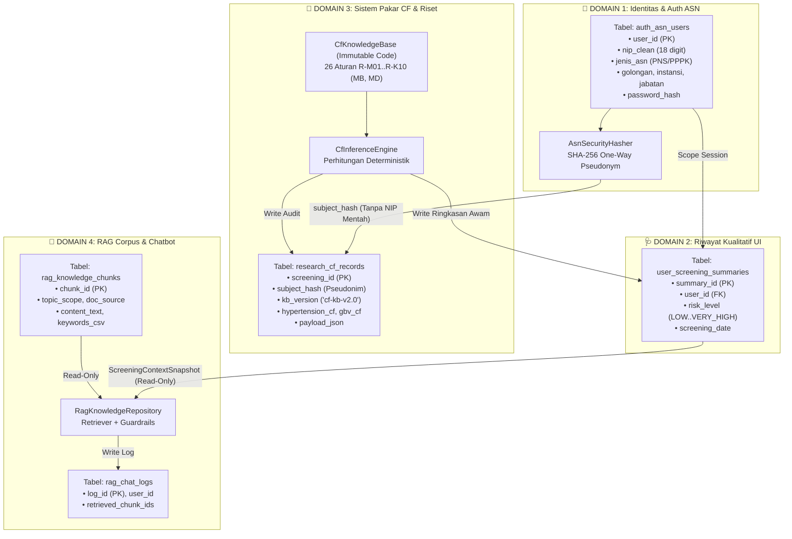
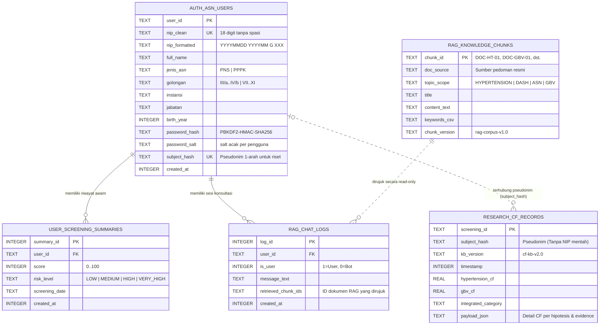
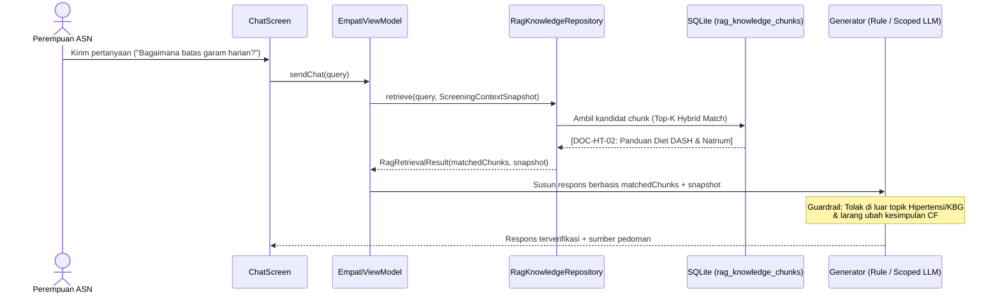

# 🗄️ SRYA Emora (sebelumnya AI-EMPATI) — Arsitektur Database (SQLite Lokal + Supabase Cloud), Otentikasi Multi-Format & Integrasi LLM OpenRouter (v4.1)

Dokumen ini mendokumentasikan arsitektur **Hybrid Database (*Local SQLite Zero-Collision* v3 + *Supabase Cloud Postgres Sync*)**, mekanisme **Login & Registrasi Inklusif untuk Semua Kalangan** (mendukung Email, No. HP, Username, NIK 16 digit, maupun NIP 18 digit untuk kohort disertasi), serta desain **Chatbot SRYA Emora Berbasis LLM Murni Terbatasi Topik melalui OpenRouter & Supabase Edge Function (`empati-chat`)** agar ketiganya berjalan berdampingan dengan **Sistem Pakar Certainty Factor (CF)** tanpa pernah saling menimpa atau membocorkan identitas pribadi responden.

---

## 📋 Daftar Isi

1. [Mengapa Harus Arsitektur *Zero-Collision*?](#1-mengapa-harus-arsitektur-zero-collision)
2. [Diagram Arsitektur 4-Domain Terisolasi](#2-diagram-arsitektur-4-domain-terisolasi)
3. [Spesifikasi Login & Registrasi Inklusif (Semua Kalangan)](#3-spesifikasi-login--registrasi-inklusif-semua-kalangan)
   - [Dukungan Identitas Multi-Format (`validateGeneralIdentity`)](#dukungan-identitas-multi-format-validategeneralidentity)
   - [Inspektor Anatomi 18 Digit NIP Opsional (Kohort Riset Disertasi)](#inspektor-anatomi-18-digit-nip-opsional-kohort-riset-disertasi)
   - [Atribut Demografi & Latar Belakang Inklusif](#atribut-demografi--latar-belakang-inklusif)
   - [Pseudonymization Firewall (`subject_hash`) untuk Perlindungan Privasi KBG](#pseudonymization-firewall-subject_hash-untuk-perlindungan-privasi-kbg)
4. [Skema Tabel Database (`EmpatiDatabase.kt`)](#4-skema-tabel-database-empatidatabasekt)
   - [Entity-Relationship Diagram (ERD)](#entity-relationship-diagram-erd)
   - [Rincian 5 Tabel dalam 4 Domain](#rincian-5-tabel-dalam-4-domain)
5. [Mekanisme Anti-Tabrakan: Sistem Pakar CF vs RAG Chatbot](#5-mekanisme-anti-tabrakan-sistem-pakar-cf-vs-rag-chatbot)
   - [Matriks Hak Akses (Read/Write Isolation Matrix)](#matriks-hak-akses-readwrite-isolation-matrix)
   - [Jembatan Konteks Satu Arah (`ScreeningContextSnapshot`)](#jembatan-konteks-satu-arah-screeningcontextsnapshot)
6. [Arsitektur Retrieval-Augmented Generation (RAG) pada Chatbot](#6-arsitektur-retrieval-augmented-generation-rag-pada-chatbot)
   - [Alur Pipeline RAG Terproteksi](#alur-pipeline-rag-terproteksi)
   - [Struktur Korpus & Strategi Hybrid Retrieval](#struktur-korpus--strategi-hybrid-retrieval)
7. [Referensi Implementasi Kode](#7-referensi-implementasi-kode)
8. [Status Implementasi & Cara Menggunakan/Memverifikasi](#8-status-implementasi--cara-menggunakanmemverifikasi)

---

## 1. Mengapa Harus Arsitektur *Zero-Collision*?

Dalam aplikasi kesehatan berbasis AI yang menggabungkan **Otentikasi Kepegawaian (ASN)**, **Sistem Pakar Diagnostik/Skrining (Certainty Factor)**, dan **Chatbot berbasis RAG**, terdapat tiga risiko tabrakan data (*architectural collision*) yang harus dicegah sejak level skema database:

1. **Tabrakan Pengetahuan (*Knowledge Collision*)**:
   - *Sistem Pakar CF* membutuhkan aturan matematis yang **pasti, deterministik, dan terukur** (`MB`, `MD`, bobot pakar di [`CfKnowledgeBase.kt`](file:///c:/Users/ADVAN/AndroidStudioProjects/Empati/app/src/main/java/com/example/empati/data/cf/CfKnowledgeBase.kt)).
   - *RAG Chatbot* membutuhkan potongan dokumen naratif (`chunks` pedoman Kemenkes, Diet DASH, UU TPKS) untuk menjawab pertanyaan bebas.
   - **Solusi**: Aturan CF dan dokumen RAG disimpan di domain yang **terpisah total**. RAG tidak pernah diizinkan mengubah atau mengintervensi perhitungan CF.
2. **Tabrakan Privasi Kepegawaian (*Identity-Sensitivity Collision*)**:
   - Pengguna adalah **Perempuan ASN** yang memasukkan NIP resmi, Instansi/OPD, dan Jabatan. Namun kuesioner Modul 2 memuat pertanyaan sensitif terkait **Kekerasan Berbasis Gender (KBG)** di tempat kerja.
   - **Solusi**: Tabel identitas ASN (`auth_asn_users`) dipisahkan dari tabel rekam medis/riset CF (`research_cf_records`) melalui **Pseudonymization Firewall** satu arah (`subject_hash = SHA-256(salt + NIP)`).
3. **Tabrakan Tampilan Pengguna vs Data Penelitian (*UI-Research Collision*)**:
   - Pengguna awam hanya boleh melihat kesimpulan kualitatif ringkas, sedangkan peneliti membutuhkan log CF lengkap.
   - **Solusi**: Tabel `user_screening_summaries` (untuk UI & konteks RAG) dipisahkan secara fisik dari tabel `research_cf_records` (untuk audit riset).

---

## 2. Diagram Arsitektur 4-Domain Terisolasi



---

## 3. Spesifikasi Login & Registrasi Inklusif (Semua Kalangan)

Diimplementasikan pada [`AsnNipValidator.kt`](file:///c:/Users/ADVAN/AndroidStudioProjects/Empati/app/src/main/java/com/example/empati/data/auth/AsnNipValidator.kt) dan [`AuthScreen.kt`](file:///c:/Users/ADVAN/AndroidStudioProjects/Empati/app/src/main/java/com/example/empati/ui/screens/AuthScreen.kt).

### Dukungan Identitas Multi-Format (`validateGeneralIdentity`)

Agar aplikasi dapat diakses oleh **semua kalangan masyarakat**, portal autentikasi mendukung berbagai format identitas akun:
- **Email** (mis. `ratna.andari@empati.id`, `pengguna@gmail.com`)
- **Nomor HP / WhatsApp** (mis. `081234567890` atau `+6281234567890`)
- **Username** (minimal 4 karakter, mis. `siti_rahma`)
- **NIK 16 Digit** (Nomor Induk Kependudukan umum)
- **NIP 18 Digit** (opsional bagi pengguna berlatar belakang ASN / Instansi Publik)

### Inspektor Anatomi 18 Digit NIP Opsional (Kohort Riset Disertasi)

Apabila pengguna memasukkan **18 digit angka** (`YYYYMMDD YYYYMM G XXX`), sistem secara otomatis mengaktifkan *Live NIP Anatomy Inspector* untuk mengekstrak tahun lahir dan masa kerja (menerima kode gender `1` Laki-laki maupun `2` Perempuan):

```
  19850312          201001            2            014
└────┬────┘       └────┬───┘        └─┬─┘        └──┬──┘
 Digit 1–8         Digit 9–14      Digit 15     Digit 16–18
Tanggal Lahir     TMT Pengangkatan  Kode Gender   Nomor Urut
(12 Mar 1985)      (Januari 2010)  (1=Laki/2=Per)   (014)
```

### Atribut Demografi & Latar Belakang Inklusif

Saat melakukan **Registrasi Akun Baru**, pengguna dapat memilih profil demografi yang sesuai:
1. **Kategori Latar Belakang (`jenis_asn` / `UserOccupationCategory`)**:
   - `Masyarakat Umum`, `Karyawan / Pekerja`, `Wiraswasta / UMKM`, `Mahasiswa / Pelajar`, `Ibu Rumah Tangga`, `ASN / Instansi Publik`, `Tenaga Medis / Pendidik`.
2. **Jenis Kelamin (`golongan` / `UserGenderOption`)**:
   - `Perempuan` atau `Laki-laki`.
3. **Domisili / Instansi / Komunitas (`instansi`)** & **Pekerjaan / Aktivitas Utama (`jabatan`)**.
4. **PIN / Kata Sandi Privasi Lokal**: Disimpan sebagai **PBKDF2-HMAC-SHA256 (120.000 iterasi)** dengan **salt acak 16 byte per pengguna** (kolom `password_salt`).

### Pseudonymization Firewall (`subject_hash`) untuk Perlindungan Privasi KBG

> [!IMPORTANT]
> Karena responden sering khawatir jawaban skrining **Kekerasan Berbasis Gender (KBG)** dapat dilacak balik ke identitas pribadi mereka, AI-EMPATI menerapkan **Pseudonymization Firewall**:
> - Tabel `research_cf_records` **tidak memiliki kolom `nip_clean`, email, nomor HP, maupun `user_id`**.
> - Sebagai gantinya, digunakan `subject_hash = "sub_" + SHA256("empati-asn-research-v2:" + normalizedAccountId).take(20)`.
> - Peneliti tetap dapat menganalisis tren longitudinal dari responden yang sama menggunakan `subject_hash`, tanpa menyimpan identitas mentah pada tabel riset.

> [!WARNING]
> **Batasan saat ini:** ini adalah *pseudonimisasi*, bukan anonimisasi. Karena NIP memiliki struktur yang dapat ditebak (tanggal lahir, TMT, kode gender, nomor urut) dan namespace hash ada di kode sumber, pihak yang memegang file database **dan** kode sumber secara teoretis dapat mencoba menebak NIP dengan brute-force. Untuk penelitian sungguhan, ganti dengan **HMAC-SHA256 menggunakan kunci rahasia** (disimpan di Android Keystore atau dipegang tim peneliti), dan lindungi file database dengan enkripsi (mis. SQLCipher).

---

## 4. Skema Tabel Database (`EmpatiDatabase.kt`)

### Entity-Relationship Diagram (ERD)



### Rincian 5 Tabel dalam 4 Domain

| Domain | Nama Tabel SQLite | Kunci Utama | Fungsi Utama |
|---|---|---|---|
| **1. Auth ASN** | `auth_asn_users` | `user_id` | Menyimpan profil kepegawaian ASN, kredensial ter-hash, dan `subject_hash`. |
| **2. UI Summary** | `user_screening_summaries` | `summary_id` | Menyimpan ringkasan risiko kualitatif per pengguna untuk Beranda & Riwayat. |
| **3. Sistem Pakar CF** | `research_cf_records` | `screening_id` | Menyimpan rincian nilai CF, MB/MD, dan evidence disertai penanda versi `kb_version`. |
| **4a. RAG Corpus** | `rag_knowledge_chunks` | `chunk_id` | Menyimpan potongan dokumen pedoman klinis & hukum terverifikasi untuk pencarian RAG. |
| **4b. Chat Logs** | `rag_chat_logs` | `log_id` | Menyimpan percakapan pengguna dan ID dokumen RAG (`retrieved_chunk_ids`) yang digunakan. |

---

## 5. Mekanisme Anti-Tabrakan: Sistem Pakar CF vs RAG Chatbot

### Matriks Hak Akses (*Read/Write Isolation Matrix*)

Tabel berikut menjamin **tidak ada komponen yang saling menimpa**:

| Komponen / Mesin | `CfKnowledgeBase` (Kode Aturan) | `research_cf_records` (Audit CF) | `user_screening_summaries` (Ringkasan UI) | `rag_knowledge_chunks` (Dokumen RAG) | `rag_chat_logs` (Riwayat Chat) |
|---|---|---|---|---|---|
| **Sistem Pakar CF (`CfInferenceEngine`)** | ✅ **READ** | ✅ **WRITE** | ✅ **WRITE** | ❌ *Tidak Akses* | ❌ *Tidak Akses* |
| **Presenter Awam (`UserResultPresenter`)** | ❌ *Tidak Akses* | ❌ *Tidak Akses* | ✅ **READ** | ❌ *Tidak Akses* | ❌ *Tidak Akses* |
| **RAG & Chatbot (`RagKnowledgeRepository`)** | ❌ *Tidak Akses* | ❌ *Tidak Akses* | 🔒 **READ SNAPSHOT** | ✅ **READ** | ✅ **WRITE** |
| **Modul Auth ASN (`AsnNipValidator`)** | ❌ *Tidak Akses* | ❌ *Tidak Akses* | ❌ *Tidak Akses* | ❌ *Tidak Akses* | ❌ *Tidak Akses* |

### Jembatan Konteks Satu Arah (`ScreeningContextSnapshot`)

Ketika pengguna bertanya di fitur Konsultasi/Chatbot (misalnya *"Analisis hasil screening saya"* atau *"Apa yang bisa Anda simpulkan dari hasil screening saya?"*), RAG/LLM **tidak membaca** tabel `research_cf_records` dan **tidak menghitung ulang CF**. Sebaliknya, sistem mengirimkan objek kualitatif [`ScreeningContextSnapshot`](file:///c:/Users/ADVAN/AndroidStudioProjects/Empati/app/src/main/java/com/example/empati/data/rag/RagKnowledgeRepository.kt#L31-L42) yang dibangun oleh [`UserResultPresenter.buildContextSnapshot()`](file:///c:/Users/ADVAN/AndroidStudioProjects/Empati/app/src/main/java/com/example/empati/data/presentation/UserResultPresenter.kt#L35-L108) dan disimpan secara persisten per pengguna di [`ScreeningStore`](file:///c:/Users/ADVAN/AndroidStudioProjects/Empati/app/src/main/java/com/example/empati/data/ScreeningStore.kt#L135-L193):

```kotlin
data class ScreeningContextSnapshot(
    val riskLevelLabel: String,                 // Contoh: "Tinggi"
    val integratedCategoryLabel: String?,       // Contoh: "Risiko Hipertensi dengan Dominasi Faktor Kesehatan dan Gaya Hidup"
    val screeningDate: String,                  // Contoh: "09 Nov 2026"
    val summaryNarrative: String? = null,       // Gambaran kualitatif terpadu
    val hypertensionStatusLabel: String? = null,// Contoh: "Tinggi · Perlu Perhatian"
    val gbvStatusLabel: String? = null,         // Contoh: "Tidak terindikasi" / "Terdapat indikasi"
    val keyFactors: List<String> = emptyList(), // Contoh: ["Pola makan & aktivitas", "Stres & kualitas tidur"]
    val protectiveFactors: List<String> = emptyList(),
    val relationshipExplanation: String? = null,
    val keyRecommendations: List<String> = emptyList()
)
```

Dengan pemisahan intent pada [`ChatEngine.kt`](file:///c:/Users/ADVAN/AndroidStudioProjects/Empati/app/src/main/java/com/example/empati/data/ChatEngine.kt) dan [`RagKnowledgeRepository.kt`](file:///c:/Users/ADVAN/AndroidStudioProjects/Empati/app/src/main/java/com/example/empati/data/rag/RagKnowledgeRepository.kt):
- **Cek Status Cepat (`isSimpleResultLookupQuery` — mis. `"Lihat hasil skrining saya"`)**: Mengembalikan ringkasan status deterministik (`snapshot-zero-leak`) secara instan.
- **Analisis & Kesimpulan Mendalam (`isScreeningAnalysisQuery` — mis. `"analisis hasil screening saya"`, `"apa yang bisa anda simpulkan dari hasil screening saya"`, `"jelaskan hasil skrining saya"`)**: Meneruskan pertanyaan ke LLM (`OpenRouter` / `Supabase Edge Function empati-chat` / `Ollama`) bersama blok `[KONTEKS HASIL SKRINING PENGGUNA SAAT INI]` pada [`OllamaRagService.buildAugmentedPrompt()`](file:///c:/Users/ADVAN/AndroidStudioProjects/Empati/app/src/main/java/com/example/empati/data/rag/OllamaRagService.kt#L129-L195) agar LLM menganalisis keterkaitan fisiologis dan psikososial dari temuan skrining pengguna secara cerdas tanpa pernah membocorkan angka teknis CF/MB/MD.

---

## 6. Arsitektur Retrieval-Augmented Generation (RAG) pada Chatbot

### Alur Pipeline RAG Terproteksi



### Struktur Korpus & Strategi Hybrid Retrieval

Korpus awal yang di-*seed* otomatis ke tabel `rag_knowledge_chunks` di [`EmpatiDatabase.kt`](file:///c:/Users/ADVAN/AndroidStudioProjects/Empati/app/src/main/java/com/example/empati/data/db/EmpatiDatabase.kt) dan [`RagKnowledgeRepository.kt`](file:///c:/Users/ADVAN/AndroidStudioProjects/Empati/app/src/main/java/com/example/empati/data/rag/RagKnowledgeRepository.kt):

| `chunk_id` | `topic_scope` | Sumber Resmi (`doc_source`) | Topik Inti |
|---|---|---|---|
| `DOC-HT-01` | `HYPERTENSION_CLINICAL` | Pedoman Tatalaksana Hipertensi Kemenkes RI | Klasifikasi tekanan darah optimal, pra-hipertensi, dan hipertensi ($\ge 140/90\text{ mmHg}$). |
| `DOC-HT-02` | `LIFESTYLE_DASH` | Panduan Diet DASH & Konsumsi Natrium WHO/Kemenkes | Batas garam $<1$ sendok teh/hari ($2.000\text{ mg}$ natrium) dan asupan tinggi kalium. |
| `DOC-HT-03` | `LIFESTYLE_DASH` | Rekomendasi Aktivitas Fisik Kardiovaskular | Olahraga aerobik 150 menit/minggu bagi pekerja kantoran. |
| `DOC-ASN-01` | `ASN_PSYCHOSOCIAL` | Kesehatan Kerja & Manajemen Stres ASN | Hubungan beban kerja birokrasi, tidur $<7$ jam, kortisol, dan tekanan darah. |
| `DOC-GBV-01` | `GBV_PROTECTION` | UU TPKS & Layanan KemenPPPA (SAPA 129) | Perlindungan korban kekerasan di lingkungan kerja dan hotline rahasia **SAPA 129**. |

**Tahap Pengembangan RAG Selanjutnya (Saat Menghubungkan Vector Embedding / LLM):**
1. Kolom `chunk_version` memastikan pembaruan pedoman medis dapat di-migrasi tanpa menghapus `rag_chat_logs`.
2. Dapat menambahkan kolom `embedding_blob BLOB` (Float32 array dari model *on-device embedding* seperti Gecko/Multilingual-E5) untuk menggabungkan **Lexical Keyword Score + Cosine Similarity (Hybrid Search)**.

---

## 7. Referensi Implementasi Kode

| File | Peran dalam Arsitektur |
|---|---|
| [`AsnNipValidator.kt`](file:///c:/Users/ADVAN/AndroidStudioProjects/Empati/app/src/main/java/com/example/empati/data/auth/AsnNipValidator.kt) | Validasi 18 digit NIP/NI PPPK, ekstraksi tanggal lahir & TMT, verifikasi kode Perempuan ASN (`2`), dan `AsnSecurityHasher` (`subject_hash`). |
| [`EmpatiDatabase.kt`](file:///c:/Users/ADVAN/AndroidStudioProjects/Empati/app/src/main/java/com/example/empati/data/db/EmpatiDatabase.kt) | SQLite database multi-domain lokal (`auth_asn_users`, `user_screening_summaries`, `research_cf_records`, `rag_knowledge_chunks`, `rag_chat_logs`). |
| [`SupabaseCloudSyncService.kt`](file:///c:/Users/ADVAN/AndroidStudioProjects/Empati/app/src/main/java/com/example/empati/data/cloud/SupabaseCloudSyncService.kt) | Sinkronisasi *Local-First + Cloud Sync* ke project Supabase **`empati-research`** (`https://qnvcuhmvrrffzdxxdloc.supabase.co`) untuk tabel `public.user_accounts` (termasuk `syncUserAccount`, `fetchUserAccountByIdentifier` di background thread bebas `NetworkOnMainThreadException`, dan `deleteUserAccount`), `public.research_cf_records` (upsert idempoten dengan fallback `INSERT`), dan `public.research_chat_logs`, serta pemanggilan Edge Function `empati-chat`. |
| [`20261108000001_create_empati_research_schema.sql`](file:///c:/Users/ADVAN/AndroidStudioProjects/Empati/supabase/migrations/20261108000001_create_empati_research_schema.sql) | Skema DDL Postgres Supabase dengan Row-Level Security (RLS) aktif untuk `user_accounts` (`id bigint generated always as identity primary key`, `account_identifier unique`, trigger `trg_user_accounts_updated_at`, serta kebijakan `SELECT`, `INSERT`, `UPDATE`, `DELETE` tervalidasi), `research_cf_records` (mendukung upsert idempoten `?on_conflict=screening_id` tanpa bocoran PII), dan `research_chat_logs`. |
| [`index.ts`](file:///c:/Users/ADVAN/AndroidStudioProjects/Empati/supabase/functions/empati-chat/index.ts) | Supabase Edge Function (`empati-chat`) yang mem-proxy permintaan konsultasi ke **OpenRouter API** (`https://openrouter.ai/api/v1/chat/completions`) dengan urutan prioritas **Free-Tier Smart Router (`openrouter/free`)** → `meta-llama/llama-3.3-70b-instruct:free` → `google/gemma-3-12b-it:free` → `qwen/qwen3-8b:free` → model berbayar opsional → *keyless cloud fallback*, menggunakan secret `OPENROUTER_API_KEY` di sisi server. |
| [`RagKnowledgeRepository.kt`](file:///c:/Users/ADVAN/AndroidStudioProjects/Empati/app/src/main/java/com/example/empati/data/rag/RagKnowledgeRepository.kt) | Model `RagDocumentChunk`, `ScreeningContextSnapshot`, dan mesin *retriever* bebas tabrakan dengan CF. |
| [`WebRagSearchService.kt`](file:///c:/Users/ADVAN/AndroidStudioProjects/Empati/app/src/main/java/com/example/empati/data/rag/WebRagSearchService.kt) | Layanan **Live Internet RAG** yang mengambil rujukan medis langsung dari internet (**Wikipedia Medis Indonesia API** & **Europe PMC / PubMed REST API**), mensterilkan teks (*Zero-Leak*), dan meng-cache hasilnya ke tabel SQLite `rag_knowledge_chunks`. |
| [`OllamaRagService.kt`](file:///c:/Users/ADVAN/AndroidStudioProjects/Empati/app/src/main/java/com/example/empati/data/rag/OllamaRagService.kt) | Service layer generator LLM yang menghubungkan **OpenRouter** (langsung atau via Supabase Edge Function `empati-chat`) serta Ollama lokal dengan firewall privasi NIP/NIK/Email/HP, *topic scoping*, *Zero-Leak*, *chronic stress pathway*, rujukan wajib **SAPA 129**, dan *offline-first fallback*. |
| [`Modelfile.empati-qwen`](file:///c:/Users/ADVAN/AndroidStudioProjects/Empati/ollama/Modelfile.empati-qwen) | Definisi Modelfile Ollama berbasis `qwen2.5:3b-instruct` dengan parameter terkalibrasi (`temperature 0.25`) dan *System Prompt* klinis AI-EMPATI. |
| [`ScreeningStore.kt`](file:///c:/Users/ADVAN/AndroidStudioProjects/Empati/app/src/main/java/com/example/empati/data/ScreeningStore.kt) | Repositori terpadu yang menghubungkan ViewModel dengan `EmpatiDatabase` lokal dan sinkronisasi antrean otomatis ke Cloud Supabase (`syncPendingResearchToSupabase` saat kuesioner selesai, saat login, dan saat aplikasi dibuka). |
| [`AuthScreen.kt`](file:///c:/Users/ADVAN/AndroidStudioProjects/Empati/app/src/main/java/com/example/empati/ui/screens/AuthScreen.kt) | Antarmuka Login & Registrasi multi-format berbasis `AuthFormState`, `SegmentedSwitch`, `EmpatiTextField`, dan `IdentityConfirmationCard` (`EmpatiMetricStyle`). |
| [`AsnAndRagArchitectureTest.kt`](file:///c:/Users/ADVAN/AndroidStudioProjects/Empati/app/src/test/java/com/example/empati/auth/AsnAndRagArchitectureTest.kt) | Pengujian unit JVM (11 test, total 49 unit test proyek) validasi identitas multi-format, PBKDF2-HMAC-SHA256, `subject_hash`, payload Supabase & OpenRouter tanpa bocoran PII, serta guardrails LLM. |
| [`EmpatiDatabaseInstrumentedTest.kt`](file:///c:/Users/ADVAN/AndroidStudioProjects/Empati/app/src/androidTest/java/com/example/empati/EmpatiDatabaseInstrumentedTest.kt) | Pengujian *instrumented* SQLite sungguhan di perangkat/emulator (registrasi, login, isolasi riwayat antar-akun, dan penghapusan per pengguna). |

---

## 8. Status Implementasi & Cara Menggunakan/Memverifikasi

### A. Apakah Database, Login, dan Register Sudah Berfungsi?

**Ya, seluruh 5 tabel SQLite (`empati_multi_domain.db` versi 4) dan sinkronisasi Cloud Supabase (`user_accounts`, `research_cf_records`, `research_chat_logs`) sudah aktif dan terhubung penuh ke alur aplikasi tanpa akun demo:**

1. **Saat Aplikasi Pertama Kali Dibuka (`onCreate` / `onUpgrade` SQLite v4)**:
   - Membuat 5 tabel (`auth_asn_users`, `user_screening_summaries`, `research_cf_records`, `rag_knowledge_chunks`, `rag_chat_logs`) dalam keadaan bersih siap produksi (**tanpa akun demo**; migrasi v4 otomatis menghapus akun demo lama jika ada).
   - Melakukan *seed* otomatis 5 dokumen pedoman resmi ke tabel `rag_knowledge_chunks` (`DOC-HT-01` s/d `DOC-GBV-01`).
2. **Saat Registrasi Pengguna Baru (`AuthScreen` → Mode `Daftar`)**:
   - Memvalidasi format ID Akun (`validateGeneralIdentity`: Email, Nomor HP, Username, NIK 16 digit, atau NIP 18 digit).
   - Menolak jika ID Akun sudah terdaftar di `auth_asn_users`.
   - Menyimpan baris baru ke `auth_asn_users` lengkap dengan `password_salt`, `password_hash` (PBKDF2), `subject_hash`, `is_active_session = 1`, dan `cloud_synced = 0`, lalu langsung menyinkronkan akun & profil ke database Cloud Supabase (`user_accounts` & baseline demografi) **walaupun pengguna belum melakukan skrining**.
3. **Saat Login & Pembaruan Profil (`AuthScreen` / `ProfileScreen`)**:
   - Mencari ID Akun (`nip_clean`) di tabel `auth_asn_users` (dengan dukungan pemulihan dari `public.user_accounts` bila diperlukan) dan memverifikasi PIN/kata sandi terhadap `password_hash` + `password_salt` secara *constant-time*.
   - Setiap perubahan profil di `ProfileScreen` langsung disimpan ke `auth_asn_users` dan disinkronkan ke database Cloud tanpa menunggu skrining.
   - Memuat profil, riwayat skrining (`user_screening_summaries`), dan riwayat konsultasi (`rag_chat_logs`) **khusus milik `user_id` yang login** (tidak bercampur dengan akun lain).
4. **Saat Menyimpan Hasil Skrining (`saveDualResult`)**:
   - Menyimpan ringkasan kualitatif ke `user_screening_summaries` (diikat ke `user_id`).
   - Menyimpan rincian perhitungan CF lengkap ke `research_cf_records` (diikat ke pseudonim `subject_hash` dan `kb_version = 'cf-kb-v2.0'`).
5. **Saat Berkonsultasi di Chatbot (`sendChat`)**:
   - Menjawab pertanyaan identitas diri (`"siapa anda"`, `"siapa kamu"`, `"kamu bisa bantu apa"`) dengan penjelasan hangat tentang **SRYA Emora**, menjawab topik Kesehatan/Psikologi/Kekerasan menggunakan LLM, serta menyimpan percakapan ke `rag_chat_logs` dan `research_chat_logs`.

---

### B. Cara Menggunakan di Aplikasi

1. **Alur Registrasi Akun Baru (Semua Kalangan — Siap Produksi Tanpa Akun Demo)**:
   - Selesaikan 3 slide Onboarding → pada layar **SRYA Emora**, pilih tab **`Daftar`**.
   - Masukkan **ID Akun** bebas: dapat berupa **Email** (`nama@email.com`), **Nomor HP** (`081234567890`), **Username** (`pengguna_01`), **NIK 16 digit**, atau **NIP 18 digit**.
   - Pilih **Jenis Kelamin** (*Perempuan* / *Laki-laki*), pilih **Latar Belakang atau Aktivitas Utama** (*Masyarakat Umum*, *Karyawan / Pekerja*, *Wiraswasta / UMKM*, *Mahasiswa / Pelajar*, *Ibu Rumah Tangga*, *ASN / Instansi Publik*, atau *Tenaga Medis / Pendidik*), isi **Nama Lengkap**, **Kota Domisili / Tempat Beraktivitas**, **Pekerjaan / Peran Sehari-hari**, dan **PIN atau Kata Sandi minimal 6 karakter**, lalu ketuk **`Daftar dan masuk`**.
2. **Alur Masuk Kembali (`Masuk`)**:
   - Masukkan **ID Akun** dan **PIN / Kata Sandi** yang telah didaftarkan. Data akun dan profil Anda tetap tersimpan utuh di database walaupun Anda belum pernah melakukan skrining.

---

### C. Cara Mengakses Database Cloud (Supabase) & Mengonfigurasi OpenRouter Saat Deploy

1. **Mengakses & Mengekspor Data Riset Disertasi di Supabase Dashboard**:
   - Project Supabase aktif: **`empati-research`** (Project ID: `qnvcuhmvrrffzdxxdloc`, Region: `ap-southeast-1` Singapore).
   - URL Dashboard Tabel Riset: `https://supabase.com/dashboard/project/qnvcuhmvrrffzdxxdloc/editor`
   - Buka tabel **`research_cf_records`** untuk melihat seluruh hasil skrining responden secara *real-time* (`subject_hash`, `gender`, `occupation_category`, `domicile`, `score`, `risk_level`, `hypertension_cf`, `gbv_cf`, `integrated_category`, `payload_json`), lalu klik tombol **Export to CSV** untuk langsung dianalisis di SPSS, R, Excel, atau Python.
   - Buka tabel **`research_chat_logs`** untuk melihat log pertanyaan dan jawaban edukasi AI-EMPATI yang sudah disanitasi dari data pribadi.
2. **Mengatur API Key OpenRouter (`OPENROUTER_API_KEY`)**:
   - **Cara 1 (Paling Aman untuk Produksi — Di Sisi Server Supabase Edge Function)**:
     Buka `https://supabase.com/dashboard/project/qnvcuhmvrrffzdxxdloc/functions/secrets` lalu tambahkan secret bernama `OPENROUTER_API_KEY` berisi kunci `sk-or-v1-...` Anda. Edge Function `empati-chat` (`https://qnvcuhmvrrffzdxxdloc.supabase.co/functions/v1/empati-chat`) akan otomatis menggunakan kunci tersebut untuk memanggil `https://openrouter.ai/api/v1/chat/completions` (`qwen/qwen-2.5-7b-instruct`) tanpa pernah mengekspos kunci di dalam file APK!
   - **Cara 2 (Melalui `local.properties` Saat Build APK)**:
     Tambahkan baris `OPENROUTER_API_KEY=sk-or-v1-...` di file `local.properties` sebelum menjalankan `./gradlew assembleRelease`.
3. **Melalui Android Studio Database Inspector (Lokal) & Pengujian Otomatis**:
   - **Unit Test JVM (48 test — tanpa emulator):**
     ```bash
     ./gradlew testDebugUnitTest
     ```
   - **Instrumented SQLite Test (6 test — menjalankan SQLite sungguhan di emulator/HP):**
     ```bash
     ./gradlew connectedDebugAndroidTest
     ```


