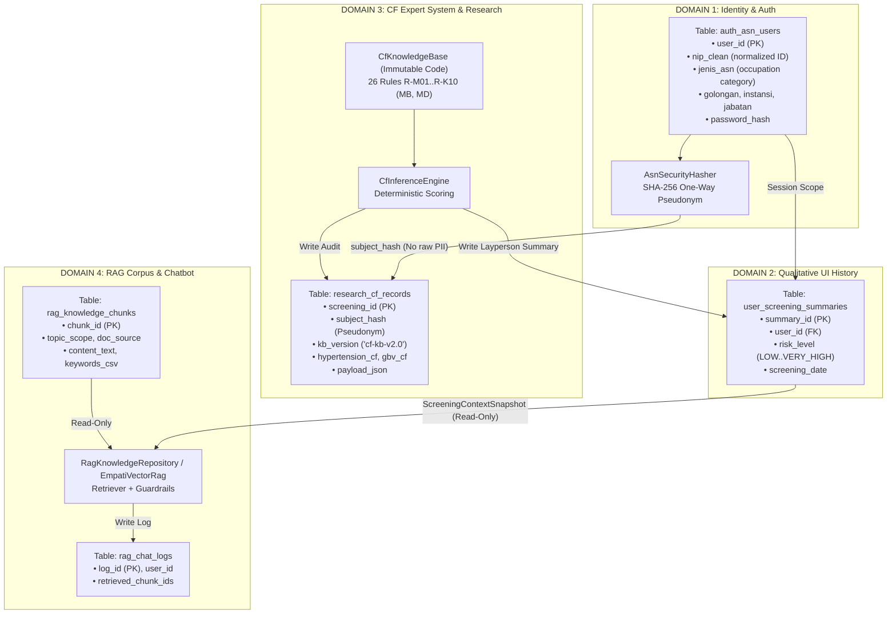
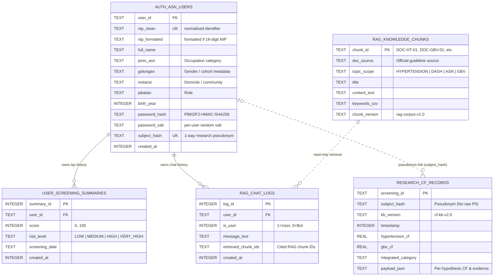
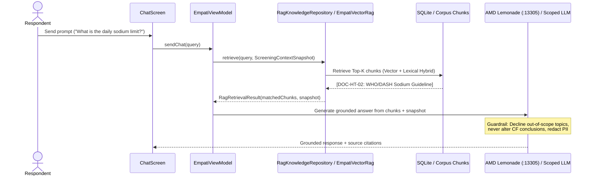

# Empati — Database Architecture (Local SQLite + Supabase Sync), Multi-Format Auth & Zero-Collision RAG (v4.1 Baseline)

> **Historical Context Notice (AMD Lemonade Architecture):**
> This document details the **v4.1 zero-collision 4-domain database, authentication, and initial RAG design** (originally authored under the *SRYA Emora* name using OpenRouter / legacy Ollama `:11434` and the initial 5-chunk seed). In the **current AMD Lemonade Challenge build**:
> - Local LLM inference, `nomic-embed-text-v1` vector RAG (`EmpatiVectorRag`, expanded to **30 evidence chunks**), `Whisper-Large-v3-Turbo` speech-to-text, and `kokoro-v1` text-to-speech run directly against **AMD Lemonade Server (`:13305`)** via `LemonadeUnifiedClient` (with hybrid fallback paths when configured).
> - See [`README.md`](README.md), [`docs/adr/001-lemonade-hybrid-architecture.md`](docs/adr/001-lemonade-hybrid-architecture.md), and [`docs/specs/lemonade-hybrid-triage.md`](docs/specs/lemonade-hybrid-triage.md) for the current competition specification and verified test counts (`203` tests / `24` suites).

This document captures the **Hybrid Database (Zero-Collision Local SQLite + Supabase Postgres Sync)** architecture, **Inclusive Multi-Format Authentication** (supporting Email, Phone Number, Username, 16-digit NIK, or 18-digit NIP for research cohorts), and **Topic-Scoped RAG Isolation** so all domains operate alongside the **Certainty Factor (CF) Expert System** without overwriting clinical rules or leaking sensitive respondent identities.

---

## Table of Contents

1. [Why a Zero-Collision Architecture?](#1-why-a-zero-collision-architecture)
2. [4-Domain Isolated Architecture Diagram](#2-4-domain-isolated-architecture-diagram)
3. [Inclusive Sign-In & Registration Specification](#3-inclusive-sign-in--registration-specification)
   - [Multi-Format Identity Support (`validateGeneralIdentity`)](#multi-format-identity-support-validategeneralidentity)
   - [Optional 18-Digit NIP Anatomy Inspector (Research Cohort)](#optional-18-digit-nip-anatomy-inspector-research-cohort)
   - [Inclusive Demographic & Background Attributes](#inclusive-demographic--background-attributes)
   - [Pseudonymization Firewall (`subject_hash`) for GBV Privacy](#pseudonymization-firewall-subject_hash-for-gbv-privacy)
4. [Database Table Schema (`EmpatiDatabase.kt`)](#4-database-table-schema-empatidatabasekt)
   - [Entity-Relationship Diagram (ERD)](#entity-relationship-diagram-erd)
   - [5 Tables Across 4 Domains](#5-tables-across-4-domains)
5. [Anti-Collision Safeguards: CF Expert System vs. RAG Chatbot](#5-anti-collision-safeguards-cf-expert-system-vs-rag-chatbot)
   - [Read/Write Isolation Matrix](#readwrite-isolation-matrix)
   - [One-Way Context Bridge (`ScreeningContextSnapshot`)](#one-way-context-bridge-screeningcontextsnapshot)
6. [Retrieval-Augmented Generation (RAG) Pipeline](#6-retrieval-augmented-generation-rag-pipeline)
   - [Protected RAG Data Flow](#protected-rag-data-flow)
   - [Initial Corpus Structure & Hybrid Retrieval Strategy](#initial-corpus-structure--hybrid-retrieval-strategy)
7. [Implementation File References](#7-implementation-file-references)
8. [Verification & Usage Guide](#8-verification--usage-guide)

---

## 1. Why a Zero-Collision Architecture?

In a clinical AI mobile application combining **Civil-Service / General Identity Auth**, a **Diagnostic Screening Expert System (Certainty Factor)**, and a **RAG Chatbot**, three structural collisions must be prevented at the schema boundary:

1. **Knowledge Collision**:
   - The *CF Expert System* requires mathematical, deterministic, reproducible weights (`MB`, `MD` in [`CfKnowledgeBase.kt`](app/src/main/java/com/example/empati/data/cf/CfKnowledgeBase.kt)).
   - The *RAG Chatbot* draws on narrative evidence chunks (Indonesian Ministry of Health / Kemenkes hypertension guidelines, WHO/DASH sodium rules, UU TPKS protection).
   - **Solution**: CF rules and RAG chunks live in strictly isolated domains. The RAG retriever or LLM can never mutate or recalculate CF expert rules.
2. **Identity-Sensitivity Collision**:
   - Respondents may enter sensitive identifiers (such as an 18-digit civil-service NIP) alongside highly sensitive **Gender-Based Violence (GBV)** disclosures.
   - **Solution**: Account tables (`auth_asn_users`) are separated from clinical/research CF audit logs (`research_cf_records`) via a one-way **Pseudonymization Firewall** (`subject_hash`).
3. **UI-Research Collision**:
   - End users must see empathetic plain-language summaries only, whereas researchers need auditable numeric CF breakdowns.
   - **Solution**: `user_screening_summaries` (UI + RAG read-only snapshot) is physically separated from `research_cf_records` (pseudonymized research logs).

---

## 2. 4-Domain Isolated Architecture Diagram



---

## 3. Inclusive Sign-In & Registration Specification

Implemented in [`AsnNipValidator.kt`](app/src/main/java/com/example/empati/data/auth/AsnNipValidator.kt) and [`AuthScreen.kt`](app/src/main/java/com/example/empati/ui/screens/AuthScreen.kt).

### Multi-Format Identity Support (`validateGeneralIdentity`)

To keep the platform accessible to the general public as well as civil-service research cohorts, the login portal accepts multiple identifier formats:
- **Email** (e.g., `ratna.andari@empati.id`, `user@example.com`)
- **Phone / WhatsApp Number** (e.g., `081234567890` or `+6281234567890`)
- **Username** (minimum 4 characters, e.g., `siti_rahma`)
- **16-Digit NIK** (Indonesian National ID format)
- **18-Digit NIP** (optional for civil-service / ASN respondents)

### Optional 18-Digit NIP Anatomy Inspector (Research Cohort)

When an **18-digit numeric identifier** (`YYYYMMDD YYYYMM G XXX`) is entered, the live NIP anatomy parser extracts birth date, appointment cohort, and gender code (`1` = Male, `2` = Female):

```text
  19850312          201001            2            014
└────┬────┘       └────┬───┘        └─┬─┘        └──┬──┘
 Digits 1–8       Digits 9–14      Digit 15     Digits 16–18
 Birth Date       Appointment     Gender Code   Serial Index
(12 Mar 1985)     (Jan 2010)    (1=M / 2=F)      (014)
```

### Inclusive Demographic & Background Attributes

During registration, users select inclusive demographic fields stored locally:
1. **Occupation / Background (`UserOccupationCategory`)**: Public/General, Employee/Worker, Entrepreneur/MSME, Student, Homemaker, Civil Servant (ASN), Healthcare/Educator.
2. **Gender (`UserGenderOption`)**: Female or Male.
3. **Domicile / Community (`instansi`)** & **Primary Role (`jabatan`)**.
4. **Local PIN / Passcode**: Hashed using **PBKDF2-HMAC-SHA256 (120,000 iterations)** with a **per-user random 16-byte salt** (`password_salt`).

### Pseudonymization Firewall (`subject_hash`) for GBV Privacy

> [!IMPORTANT]
> Because respondents may fear that sensitive **Gender-Based Violence (GBV)** disclosures could be traced back to personal IDs, Empati enforces a **Pseudonymization Firewall**:
> - `research_cf_records` contains **no `nip_clean`, email, phone number, or `user_id` columns**.
> - Instead, it stores `subject_hash = "sub_" + SHA256("empati-asn-research-v2:" + normalizedAccountId).take(20)`.
> - Researchers can track longitudinal screening outcomes per respondent via `subject_hash` without exposing raw identity fields inside research exports.

> [!WARNING]
> **Current cryptographic limitation:** SHA-256 over a structured input (`YYYYMMDD...`) with an open-source static salt constitutes **pseudonymization**, not formal anonymization—someone holding both the database dump and source code could brute-force predictable ID structures. Before production clinical trials, migrate to **HMAC-SHA256 backed by a hardware/Keystore or study-PI secret key** and encrypt the SQLite database file (e.g., via SQLCipher).

---

## 4. Database Table Schema (`EmpatiDatabase.kt`)

### Entity-Relationship Diagram (ERD)



### 5 Tables Across 4 Domains

| Domain | SQLite Table | Primary Key | Primary Responsibility |
|---|---|---|---|
| **1. Auth** | `auth_asn_users` | `user_id` | Stores demographic profile, PBKDF2 credential hash, and `subject_hash`. |
| **2. UI Summary** | `user_screening_summaries` | `summary_id` | Stores qualitative risk summaries per user for Home & History views. |
| **3. CF Expert System** | `research_cf_records` | `screening_id` | Audits full CF/MB/MD breakdowns tagged with `kb_version` under `subject_hash`. |
| **4a. RAG Corpus** | `rag_knowledge_chunks` | `chunk_id` | Stores verified clinical and legal guideline excerpts for retrieval. |
| **4b. Chat Logs** | `rag_chat_logs` | `log_id` | Stores user/assistant turns and retrieved `chunk_id` citations. |

---

## 5. Anti-Collision Safeguards: CF Expert System vs. RAG Chatbot

### Read/Write Isolation Matrix

| Component | `CfKnowledgeBase` (Code Rules) | `research_cf_records` (CF Audit) | `user_screening_summaries` (UI Summary) | `rag_knowledge_chunks` (RAG Docs) | `rag_chat_logs` (Chat History) |
|---|---|---|---|---|---|
| **CF Engine (`CfInferenceEngine`)** | READ | WRITE | WRITE | No Access | No Access |
| **Lay Presenter (`UserResultPresenter`)** | No Access | No Access | READ | No Access | No Access |
| **RAG & Chatbot (`RagKnowledgeRepository`)** | No Access | No Access | READ SNAPSHOT | READ | WRITE |
| **Auth Validator (`AsnNipValidator`)** | No Access | No Access | No Access | No Access | No Access |

### One-Way Context Bridge (`ScreeningContextSnapshot`)

When a user asks about their screening inside Consultation/Chat, the RAG layer never reads `research_cf_records` and never recomputes CF weights. Instead, [`UserResultPresenter`](app/src/main/java/com/example/empati/data/presentation/UserResultPresenter.kt) constructs a zero-leak [`ScreeningContextSnapshot`](app/src/main/java/com/example/empati/data/rag/RagKnowledgeRepository.kt):

```kotlin
data class ScreeningContextSnapshot(
    val riskLevelLabel: String,
    val integratedCategoryLabel: String?,
    val screeningDate: String,
    val summaryNarrative: String? = null,
    val hypertensionStatusLabel: String? = null,
    val gbvStatusLabel: String? = null,
    val keyFactors: List<String> = emptyList(),
    val protectiveFactors: List<String> = emptyList(),
    val relationshipExplanation: String? = null,
    val keyRecommendations: List<String> = emptyList()
)
```

Intent routing inside [`ChatEngine.kt`](app/src/main/java/com/example/empati/data/ChatEngine.kt) and [`RagKnowledgeRepository.kt`](app/src/main/java/com/example/empati/data/rag/RagKnowledgeRepository.kt) separates:
- **Quick Status Lookup (`isSimpleResultLookupQuery`)**: Returns a deterministic zero-leak summary immediately.
- **Contextual Clinical Synthesis (`isScreeningAnalysisQuery`)**: Attaches `[KONTEKS HASIL SKRINING PENGGUNA SAAT INI]` (in runtime Bahasa Indonesia) to the augmented LLM prompt so the model explains physiological/psychosocial connections without ever inventing or leaking numeric CF scores.

---

## 6. Retrieval-Augmented Generation (RAG) Pipeline

### Protected RAG Data Flow



### Initial Corpus Structure & Hybrid Retrieval Strategy

Originally seeded with 5 core documents in `EmpatiDatabase.kt` (and **now expanded to 30 bilingual/clinical chunks in [`EmpatiCorpus.kt`](app/src/main/java/com/example/empati/data/rag/EmpatiCorpus.kt) indexed via `nomic-embed-text-v1` cosine similarity in [`EmpatiVectorRag.kt`](app/src/main/java/com/example/empati/data/rag/EmpatiVectorRag.kt)**):

| `chunk_id` (v4.1 Seed) | `topic_scope` | Official Source (`doc_source`) | Core Topic |
|---|---|---|---|
| `DOC-HT-01` | `HYPERTENSION_CLINICAL` | Kemenkes RI Hypertension Management Guideline | Optimal, pre-hypertension, and Stage 1/2 thresholds (≥ 140/90 mmHg). |
| `DOC-HT-02` | `LIFESTYLE_DASH` | WHO / Kemenkes DASH & Sodium Guidelines | Sodium intake cap (< 1 tsp / 2,000 mg sodium/day) & potassium balance. |
| `DOC-HT-03` | `LIFESTYLE_DASH` | Cardiovascular Physical Activity Recommendations | 150 minutes/week aerobic activity for desk-based workers. |
| `DOC-ASN-01` | `ASN_PSYCHOSOCIAL` | Occupational Health & Stress Management | Workplace workload, < 7h sleep, cortisol elevation, and blood pressure. |
| `DOC-GBV-01` | `GBV_PROTECTION` | UU TPKS & KemenPPPA **SAPA 129** | Workplace violence protection & confidential **SAPA 129** hotline (`129` / WA `08111-129-129`). |

---

## 7. Implementation File References

| File | Role in Architecture |
|---|---|
| [`AsnNipValidator.kt`](app/src/main/java/com/example/empati/data/auth/AsnNipValidator.kt) | 18-digit NIP validation, general multi-format identity validation, and `AsnSecurityHasher` (`subject_hash`). |
| [`EmpatiDatabase.kt`](app/src/main/java/com/example/empati/data/db/EmpatiDatabase.kt) | Local multi-domain SQLite schema (`auth_asn_users`, `user_screening_summaries`, `research_cf_records`, `rag_knowledge_chunks`, `rag_chat_logs`). |
| [`SupabaseCloudSyncService.kt`](app/src/main/java/com/example/empati/data/cloud/SupabaseCloudSyncService.kt) | Optional pseudonymized sync service for `research_cf_records` and `research_chat_logs`. |
| [`20261108000001_create_empati_research_schema.sql`](supabase/migrations/20261108000001_create_empati_research_schema.sql) | Postgres DDL schema with Row-Level Security (RLS) policies for pseudonymized research tables. |
| [`index.ts`](supabase/functions/empati-chat/index.ts) | Legacy v4.1 Supabase Edge Function (`empati-chat`) OpenRouter proxy (superseded in primary competition mode by local AMD Lemonade `:13305`). |
| [`RagKnowledgeRepository.kt`](app/src/main/java/com/example/empati/data/rag/RagKnowledgeRepository.kt) | `RagDocumentChunk`, `ScreeningContextSnapshot`, and CF-isolated retrieval logic. |
| [`EmpatiVectorRag.kt`](app/src/main/java/com/example/empati/data/rag/EmpatiVectorRag.kt) | **Current** hybrid dense cosine (`nomic-embed-text-v1`) + lexical fallback retriever over 30 clinical chunks. |
| [`LemonadeUnifiedClient.kt`](app/src/main/java/com/example/empati/data/rag/LemonadeUnifiedClient.kt) | **Current** OpenAI-compatible client for AMD Lemonade `:13305` (chat, embeddings, STT, TTS). |
| [`ScreeningStore.kt`](app/src/main/java/com/example/empati/data/ScreeningStore.kt) | Repository bridging ViewModel, SQLite persistence, and sync queues. |
| [`AsnAndRagArchitectureTest.kt`](app/src/test/java/com/example/empati/auth/AsnAndRagArchitectureTest.kt) | Unit tests covering multi-format auth, PBKDF2, `subject_hash`, PII redaction, and RAG/guardrail behavior. |
| [`EmpatiDatabaseInstrumentedTest.kt`](app/src/androidTest/java/com/example/empati/EmpatiDatabaseInstrumentedTest.kt) | Instrumented SQLite device tests covering registration, sign-in, multi-user isolation, and account deletion. |

---

## 8. Verification & Usage Guide

1. **JVM Unit Tests (no emulator needed):**
   - See exact Java 21 / Windows wrapper invocation in [`README.md`](README.md#testing) (`203` unit tests across `24` suites on `testDebugUnitTest`).
2. **Instrumented SQLite Device Tests (connected device/emulator):**
   ```bash
   ./gradlew connectedDebugAndroidTest
   ```
3. **Research Export Privacy Rule:**
   - Research tables never store raw names, emails, phone numbers, NIKs, or NIPs—only `subject_hash` (`sub_<20-hex>`) and pseudonymized responses. For production deployments, ensure RLS write-only policies are verified in Supabase before enabling cloud sync (`BuildConfig.ENABLE_CLOUD_SYNC`).
