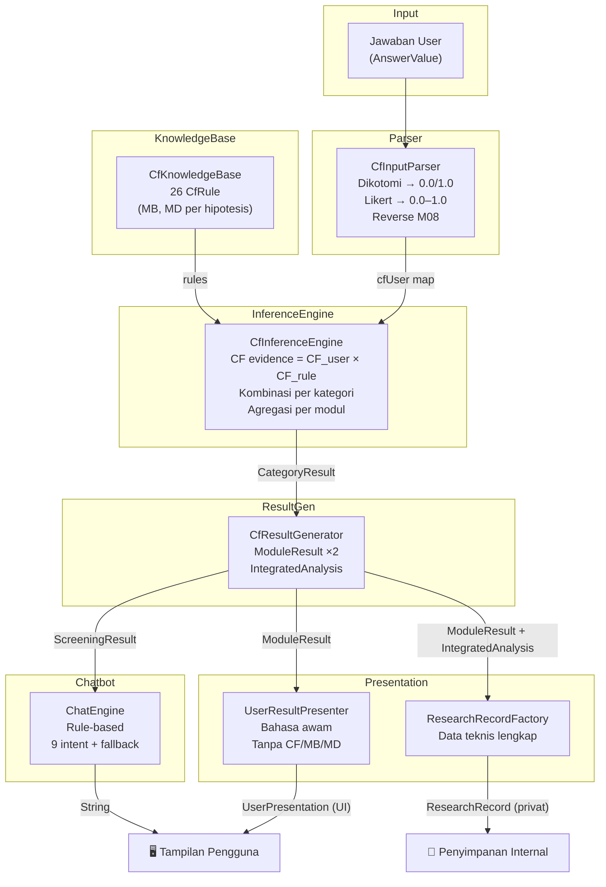
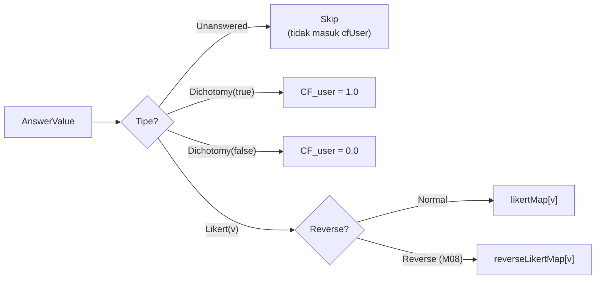
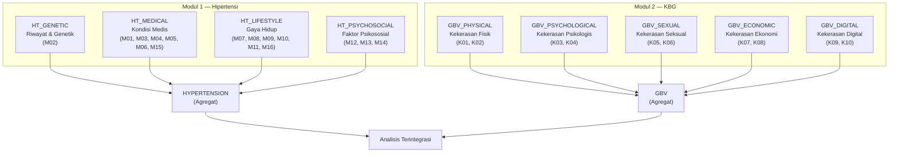
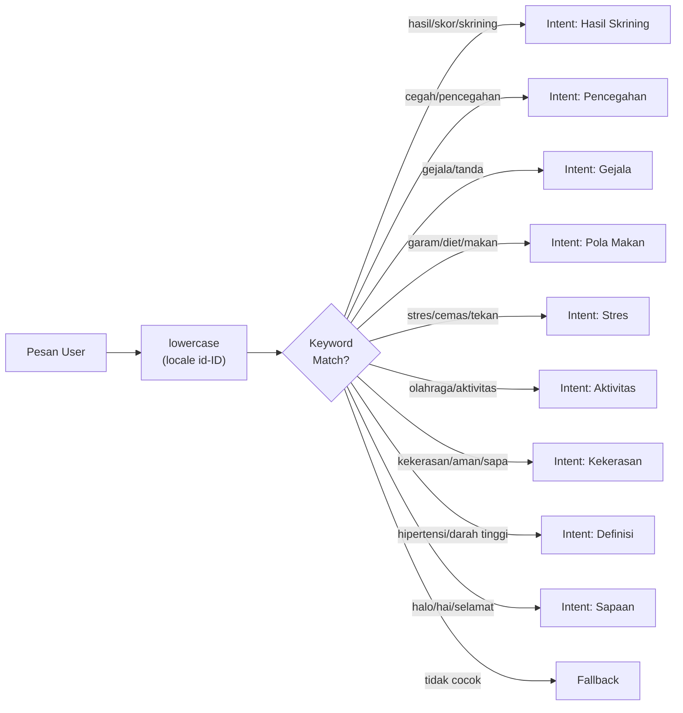

# 🧠 AI-EMPATI — Dokumentasi Sistem Pakar & Chatbot

Dokumen ini mendokumentasikan arsitektur, formula, knowledge base, dan seluruh
mekanisme inferensi sistem pakar Certainty Factor serta chatbot rule-based
pada aplikasi AI-EMPATI.

---

## 📋 Daftar Isi

- [Ikhtisar Arsitektur](#ikhtisar-arsitektur)
- [Bagian 1 — Sistem Pakar Certainty Factor](#bagian-1--sistem-pakar-certainty-factor)
  - [1.1 Teori Certainty Factor](#11-teori-certainty-factor)
  - [1.2 Bank Pertanyaan](#12-bank-pertanyaan)
  - [1.3 Input Parser](#13-input-parser)
  - [1.4 Knowledge Base (Basis Pengetahuan)](#14-knowledge-base-basis-pengetahuan)
  - [1.5 Inference Engine](#15-inference-engine)
  - [1.6 Klasifikasi Level](#16-klasifikasi-level)
  - [1.7 Analisis Terintegrasi](#17-analisis-terintegrasi)
  - [1.8 Result Generator](#18-result-generator)
- [Bagian 2 — Lapisan Presentasi](#bagian-2--lapisan-presentasi)
  - [2.1 Pemisahan Output](#21-pemisahan-output)
  - [2.2 User Result Presenter](#22-user-result-presenter)
  - [2.3 Data Penelitian](#23-data-penelitian)
- [Bagian 3 — Chatbot AI](#bagian-3--chatbot-ai)
  - [3.1 Arsitektur Chatbot](#31-arsitektur-chatbot)
  - [3.2 Pipeline Pemrosesan](#32-pipeline-pemrosesan)
  - [3.3 Taksonomi Intent](#33-taksonomi-intent)
  - [3.4 Respons Lengkap](#34-respons-lengkap)
  - [3.5 Integrasi Konteks Skrining](#35-integrasi-konteks-skrining)
  - [3.6 Titik Integrasi LLM](#36-titik-integrasi-llm)
- [Bagian 4 — Mesin Skor Legacy (v1)](#bagian-4--mesin-skor-legacy-v1)
- [Bagian 5 — Penyimpanan Data](#bagian-5--penyimpanan-data)
- [Bagian 6 — Pengujian](#bagian-6--pengujian)
- [Referensi File](#referensi-file)

---

## Ikhtisar Arsitektur



---

## Bagian 1 — Sistem Pakar Certainty Factor

### 1.1 Teori Certainty Factor

Metode **Certainty Factor (CF)** diperkenalkan oleh Shortliffe & Buchanan (1975)
dalam sistem pakar MYCIN. CF mengukur tingkat keyakinan terhadap suatu hipotesis
berdasarkan evidence (bukti) yang diamati.

#### Formula Dasar

| Konsep | Formula | Keterangan |
|---|---|---|
| **CF Pakar** | $CF_{rule} = MB - MD$ | Selisih kepercayaan dan ketidakpercayaan pakar |
| **CF Evidence** | $CF_{evidence} = CF_{user} \times CF_{rule}$ | Bobot evidence = keyakinan user × keyakinan pakar |

Dimana:
- **MB** (*Measure of Belief*) — ukuran kepercayaan terhadap hipotesis, rentang [0, 1]
- **MD** (*Measure of Disbelief*) — ukuran ketidakpercayaan terhadap hipotesis, rentang [0, 1]
- **CF_user** — tingkat keyakinan berdasarkan jawaban pengguna, rentang [0, 1]
- **CF_rule** — tingkat keyakinan pakar terhadap aturan, rentang [-1, 1]

#### Formula Kombinasi

Ketika terdapat lebih dari satu evidence untuk hipotesis yang sama, CF digabung
secara iteratif:

| Kondisi | Formula |
|---|---|
| Keduanya positif ($CF_1 > 0$ dan $CF_2 > 0$) | $CF_{combine} = CF_1 + CF_2 \times (1 - CF_1)$ |
| Keduanya negatif ($CF_1 < 0$ dan $CF_2 < 0$) | $CF_{combine} = CF_1 + CF_2 \times (1 + CF_1)$ |
| Konflik (tanda berlawanan) | $CF_{combine} = \dfrac{CF_1 + CF_2}{1 - \min(\|CF_1\|, \|CF_2\|)}$ |

> [!NOTE]
> Kombinasi positif menghasilkan nilai yang **konvergen mendekati 1.0** — semakin
> banyak evidence mendukung, semakin tinggi CF, namun tidak pernah melebihi 1.0.

#### Implementasi

```kotlin
// CfInferenceEngine.kt
fun combine(cf1: Double, cf2: Double): Double = when {
    cf1 == 0.0 -> cf2
    cf2 == 0.0 -> cf1
    cf1 > 0 && cf2 > 0 -> cf1 + cf2 * (1 - cf1)
    cf1 < 0 && cf2 < 0 -> cf1 + cf2 * (1 + cf1)
    else -> {
        val denominator = 1 - min(abs(cf1), abs(cf2))
        if (denominator == 0.0) 0.0 else (cf1 + cf2) / denominator
    }
}
```

---

### 1.2 Bank Pertanyaan

Total **26 pertanyaan** yang terbagi dalam dua modul:

#### Modul 1 — Hipertensi (M01–M16)

| ID | Kategori | Teks Pertanyaan | Tipe | Reverse |
|---|---|---|---|---|
| `M01` | Riwayat Kesehatan | Apakah Anda pernah didiagnosis hipertensi oleh tenaga kesehatan? | Dikotomi | — |
| `M02` | Riwayat Kesehatan | Apakah orang tua atau saudara kandung Anda memiliki riwayat hipertensi? | Dikotomi | — |
| `M03` | Riwayat Kesehatan | Apakah Anda memiliki riwayat diabetes melitus? | Dikotomi | — |
| `M04` | Riwayat Kesehatan | Apakah Anda sedang mengonsumsi obat tekanan darah secara rutin? | Dikotomi | — |
| `M05` | Riwayat Kesehatan | Pada pemeriksaan terakhir, apakah tekanan darah Anda di atas 130/85 mmHg? | Dikotomi | — |
| `M06` | Riwayat Kesehatan | Apakah Anda sedang hamil atau baru melahirkan dalam 6 bulan terakhir? (Pilih Tidak bila tidak berlaku) | Dikotomi | — |
| `M07` | Gaya Hidup | Seberapa sering Anda mengonsumsi makanan asin atau tinggi garam? | Likert | — |
| `M08` | Gaya Hidup | Seberapa sering Anda melakukan aktivitas fisik minimal 30 menit? | Likert | ✅ |
| `M09` | Gaya Hidup | Apakah Anda merokok atau terpapar asap rokok setiap hari? | Dikotomi | — |
| `M10` | Gaya Hidup | Seberapa sering Anda mengonsumsi kopi atau minuman berkafein secara berlebihan? | Likert | — |
| `M11` | Gaya Hidup | Apakah berat badan Anda cenderung berlebih (obesitas)? | Dikotomi | — |
| `M12` | Faktor Risiko | Seberapa sering Anda merasa stres berat akibat pekerjaan, studi, atau tanggung jawab harian dalam sebulan terakhir? | Likert | — |
| `M13` | Faktor Risiko | Apakah Anda sering tidur kurang dari 7 jam setiap malam? | Dikotomi | — |
| `M14` | Faktor Risiko | Seberapa sering Anda merasa cemas atau tertekan tanpa sebab yang jelas? | Likert | — |
| `M15` | Faktor Risiko | Apakah Anda jarang memeriksakan tekanan darah (kurang dari sekali setahun)? | Dikotomi | — |
| `M16` | Faktor Risiko | Apakah Anda mengonsumsi makanan cepat saji lebih dari 3 kali seminggu? | Dikotomi | — |

#### Modul 2 — Kekerasan Berbasis Gender / KBG (K01–K10)

| ID | Kategori | Teks Pertanyaan | Tipe | Sensitif |
|---|---|---|---|---|
| `K01` | Kekerasan Fisik | Apakah Anda pernah mengalami tindakan fisik seperti didorong, dipukul, ditampar, atau ditendang oleh seseorang di lingkungan rumah, tempat kerja, atau pergaulan? | Likert | ✅ |
| `K02` | Kekerasan Fisik | Apakah seseorang di sekitar Anda pernah melemparkan benda ke arah Anda atau melakukan tindakan fisik yang membuat Anda merasa terancam atau terluka? | Likert | ✅ |
| `K03` | Kekerasan Psikologis | Apakah Anda pernah dihina, dimaki, direndahkan, atau dipermalukan oleh pasangan, anggota keluarga, atasan, maupun orang di sekitar Anda? | Likert | ✅ |
| `K04` | Kekerasan Psikologis | Apakah Anda pernah sengaja dikucilkan, diabaikan, atau dibatasi dari interaksi sosial maupun kegiatan sehari-hari oleh orang terdekat, rekan, atau lingkungan sekitar? | Likert | ✅ |
| `K05` | Kekerasan Seksual | Apakah Anda pernah menerima komentar, candaan, atau tindakan bernuansa seksual yang tidak diinginkan di lingkungan tempat tinggal, kerja, atau ruang publik? | Likert | ✅ |
| `K06` | Kekerasan Seksual | Apakah Anda pernah mengalami sentuhan, ajakan, permintaan, atau tindakan seksual yang tidak diinginkan, termasuk tekanan atau pemaksaan dari seseorang? | Likert | ✅ |
| `K07` | Kekerasan Ekonomi | Apakah penghasilan, uang, atau hak finansial Anda pernah diambil, ditahan, atau dikuasai orang lain tanpa persetujuan Anda? | Likert | ✅ |
| `K08` | Kekerasan Ekonomi | Apakah Anda pernah dihalangi untuk bekerja, memperoleh penghasilan, melanjutkan pendidikan, atau mengembangkan diri tanpa alasan yang wajar? | Likert | ✅ |
| `K09` | Kekerasan Digital | Apakah Anda pernah mengalami penguntitan, pemantauan aktivitas digital, atau pengiriman pesan yang mengganggu secara terus-menerus melalui ponsel atau media digital? | Likert | ✅ |
| `K10` | Kekerasan Digital | Apakah Anda pernah menerima ancaman, intimidasi, penghinaan, atau penyebaran informasi pribadi melalui media sosial maupun platform pesan digital? | Likert | ✅ |

#### Label Skala Likert

| Nilai | Modul Hipertensi | Modul KBG | CF_user |
|---|---|---|---|
| 1 | Tidak pernah | Tidak pernah | 0.0 |
| 2 | Jarang | Jarang | 0.2 |
| 3 | Kadang-kadang | Cukup sering | 0.5 |
| 4 | Sering | Sering | 0.8 |
| 5 | Sangat sering | Sangat sering | 1.0 |

---

### 1.3 Input Parser

**File:** [`CfInputParser.kt`](file:///c:/Users/ADVAN/AndroidStudioProjects/Empati/app/src/main/java/com/example/empati/data/cf/CfInputParser.kt)

Parser mengonversi jawaban mentah (`AnswerValue`) menjadi nilai CF_user:



#### Pemetaan Dikotomi

| Jawaban | CF_user |
|---|---|
| Ya (`true`) | 1.0 |
| Tidak (`false`) | 0.0 |

#### Pemetaan Likert Normal

| Skala | 1 | 2 | 3 | 4 | 5 |
|---|---|---|---|---|---|
| CF_user | 0.0 | 0.2 | 0.5 | 0.8 | 1.0 |

#### Pemetaan Likert Reverse (M08)

| Skala | 1 | 2 | 3 | 4 | 5 |
|---|---|---|---|---|---|
| CF_user | 1.0 | 0.8 | 0.5 | 0.2 | 0.0 |

> [!IMPORTANT]
> **M08 bersifat reverse-scored** karena pertanyaan ini mengukur frekuensi aktivitas fisik
> (protektif). Semakin sering berolahraga → semakin rendah CF_user → semakin rendah risiko.

#### Validasi

| Kondisi | Hasil |
|---|---|
| Jawaban belum diisi (`Unanswered`) | Tidak masuk `cfUser` map — **bukan** CF 0.0 |
| Tipe jawaban salah (Dikotomi untuk Likert, atau sebaliknya) | `ValidationIssue` |
| Nilai Likert di luar 1–5 | `ValidationIssue` |

---

### 1.4 Knowledge Base (Basis Pengetahuan)

**File:** [`CfKnowledgeBase.kt`](file:///c:/Users/ADVAN/AndroidStudioProjects/Empati/app/src/main/java/com/example/empati/data/cf/CfKnowledgeBase.kt)

#### Struktur Aturan (CfRule)

```kotlin
data class CfRule(
    val id: String,              // "R-M01", "R-K03", dst.
    val questionId: String,      // "M01", "K03"
    val hypothesis: Hypothesis,  // sub-hipotesis target
    val mb: Double,              // Measure of Belief [0,1]
    val md: Double,              // Measure of Disbelief [0,1]
    val source: String,          // rujukan klinis
    val expertValidated: Boolean,// sudah divalidasi pakar?
    val note: String             // catatan validasi
) {
    val cfPakar: Double get() = mb - md  // CF rule
}
```

> [!CAUTION]
> Seluruh bobot MB/MD saat ini adalah **PLACEHOLDER** (`expertValidated = false`,
> `note = "NEEDS_EXPERT_VALIDATION"`). Bobot ini **wajib divalidasi oleh pakar kesehatan**
> sebelum digunakan untuk klaim klinis.

#### Aturan Modul Hipertensi (16 rules)

| Rule ID | Question | Hipotesis | MB | MD | CF Pakar |
|---|---|---|---|---|---|
| `R-M01` | M01 | `HT_MEDICAL` | 0.95 | 0.05 | **0.90** |
| `R-M02` | M02 | `HT_GENETIC` | 0.85 | 0.10 | **0.75** |
| `R-M03` | M03 | `HT_MEDICAL` | 0.85 | 0.10 | **0.75** |
| `R-M04` | M04 | `HT_MEDICAL` | 0.80 | 0.10 | **0.70** |
| `R-M05` | M05 | `HT_MEDICAL` | 0.90 | 0.05 | **0.85** |
| `R-M06` | M06 | `HT_MEDICAL` | 0.70 | 0.15 | **0.55** |
| `R-M07` | M07 | `HT_LIFESTYLE` | 0.75 | 0.15 | **0.60** |
| `R-M08` | M08 | `HT_LIFESTYLE` | 0.70 | 0.15 | **0.55** |
| `R-M09` | M09 | `HT_LIFESTYLE` | 0.75 | 0.15 | **0.60** |
| `R-M10` | M10 | `HT_LIFESTYLE` | 0.65 | 0.20 | **0.45** |
| `R-M11` | M11 | `HT_LIFESTYLE` | 0.80 | 0.10 | **0.70** |
| `R-M12` | M12 | `HT_PSYCHOSOCIAL` | 0.75 | 0.15 | **0.60** |
| `R-M13` | M13 | `HT_PSYCHOSOCIAL` | 0.70 | 0.15 | **0.55** |
| `R-M14` | M14 | `HT_PSYCHOSOCIAL` | 0.75 | 0.15 | **0.60** |
| `R-M15` | M15 | `HT_MEDICAL` | 0.65 | 0.20 | **0.45** |
| `R-M16` | M16 | `HT_LIFESTYLE` | 0.65 | 0.20 | **0.45** |

#### Aturan Modul KBG (10 rules)

| Rule ID | Question | Hipotesis | MB | MD | CF Pakar |
|---|---|---|---|---|---|
| `R-K01` | K01 | `GBV_PHYSICAL` | 0.90 | 0.05 | **0.85** |
| `R-K02` | K02 | `GBV_PHYSICAL` | 0.85 | 0.10 | **0.75** |
| `R-K03` | K03 | `GBV_PSYCHOLOGICAL` | 0.85 | 0.10 | **0.75** |
| `R-K04` | K04 | `GBV_PSYCHOLOGICAL` | 0.80 | 0.10 | **0.70** |
| `R-K05` | K05 | `GBV_SEXUAL` | 0.90 | 0.05 | **0.85** |
| `R-K06` | K06 | `GBV_SEXUAL` | 0.95 | 0.03 | **0.92** |
| `R-K07` | K07 | `GBV_ECONOMIC` | 0.80 | 0.10 | **0.70** |
| `R-K08` | K08 | `GBV_ECONOMIC` | 0.80 | 0.10 | **0.70** |
| `R-K09` | K09 | `GBV_DIGITAL` | 0.75 | 0.10 | **0.65** |
| `R-K10` | K10 | `GBV_DIGITAL` | 0.80 | 0.10 | **0.70** |

#### Peta Hipotesis



---

### 1.5 Inference Engine

**File:** [`CfInferenceEngine.kt`](file:///c:/Users/ADVAN/AndroidStudioProjects/Empati/app/src/main/java/com/example/empati/data/cf/CfInferenceEngine.kt)

#### Alur Inferensi

```
Untuk setiap MODUL:
  1. Filter rules berdasarkan modul
  2. Kelompokkan rules per sub-hipotesis (kategori)
  3. Untuk setiap kategori:
     a. Untuk setiap rule dalam kategori:
        - Ambil CF_user dari ParseResult
        - Hitung CF_evidence = CF_user × CF_pakar
     b. Gabungkan semua CF_evidence dengan combineAll()
     c. Simpan sebagai CategoryResult(hypothesis, cf, contributions)
  4. CF Modul = combineAll(semua CF kategori)
  5. Level = levelOf(CF Modul)
```

#### Contoh Perhitungan

Misalkan pengguna menjawab:
- `M01` = Ya (CF_user = 1.0)
- `M07` = Sering/4 (CF_user = 0.8)
- `M08` = Sering/4, reverse (CF_user = 0.2)

**Langkah 1 — CF Evidence per rule:**

| Rule | CF_user | CF_pakar | CF_evidence |
|---|---|---|---|
| R-M01 (HT_MEDICAL) | 1.0 | 0.90 | 0.900 |
| R-M07 (HT_LIFESTYLE) | 0.8 | 0.60 | 0.480 |
| R-M08 (HT_LIFESTYLE) | 0.2 | 0.55 | 0.110 |

**Langkah 2 — Kombinasi per kategori:**

- **HT_MEDICAL:** Hanya R-M01 → CF = 0.900
- **HT_LIFESTYLE:** Gabung R-M07 dan R-M08:
  - combine(0.480, 0.110) = 0.480 + 0.110 × (1 − 0.480) = 0.480 + 0.0572 = **0.5372**

**Langkah 3 — CF Modul:**
- combine(0.900, 0.5372) = 0.900 + 0.5372 × (1 − 0.900) = 0.900 + 0.05372 = **0.9537**

**Langkah 4 — Level:**
- 0.9537 ≥ 0.75 → **Sangat Tinggi**

---

### 1.6 Klasifikasi Level

| Rentang CF | Level | Label |
|---|---|---|
| CF < 0.25 | `RENDAH` | Rendah |
| 0.25 ≤ CF < 0.50 | `SEDANG` | Sedang |
| 0.50 ≤ CF < 0.75 | `TINGGI` | Tinggi |
| CF ≥ 0.75 | `SANGAT_TINGGI` | Sangat Tinggi |

---

### 1.7 Analisis Terintegrasi

**File:** [`CfResultGenerator.kt`](file:///c:/Users/ADVAN/AndroidStudioProjects/Empati/app/src/main/java/com/example/empati/data/cf/CfResultGenerator.kt) → `integrate()`

Setelah kedua modul dievaluasi, hasil digabung menjadi 1 dari 6 kategori:

#### Matriks Keputusan

| Kondisi HT (CF ≥ 0.25) | Kondisi KBG (CF ≥ 0.25) | Kondisi Tambahan | Kategori |
|---|---|---|---|
| ❌ | ❌ | — | `LOW_RISK` |
| ❌ | ✅ | — | `GBV_ONLY` |
| ✅ | ✅ | — | `HYPERTENSION_WITH_GBV_INDICATION` |
| ✅ | ❌ | `hasDiagnosis = true` | `HYPERTENSION_MEDICAL_HISTORY` |
| ✅ | ❌ | dominant = `HT_LIFESTYLE` | `HYPERTENSION_LIFESTYLE_ONLY` |
| ✅ | ❌ | lainnya | `HYPERTENSION_MEDICAL_HISTORY` |
| *(data belum lengkap)* | *(data belum lengkap)* | — | `INCONCLUSIVE` |

> [!IMPORTANT]
> Ambang indikasi (`INDICATION_THRESHOLD`) adalah **0.25**. Nilai CF di bawah
> ambang ini dianggap tidak memiliki indikasi yang cukup kuat.

#### Deskripsi Kategori

| Kategori | Label | Hubungan |
|---|---|---|
| `LOW_RISK` | Risiko Hipertensi Rendah / Normal | Kedua indikator berada pada tingkat rendah |
| `GBV_ONLY` | Indikasi KBG Tanpa Indikasi Hipertensi | KBG terindikasi tetapi **tidak otomatis** dianggap penyebab HT |
| `HYPERTENSION_WITH_GBV_INDICATION` | Hipertensi dengan Indikasi Keterkaitan KBG | Pola keterkaitan, **BUKAN bukti kausalitas** |
| `HYPERTENSION_LIFESTYLE_ONLY` | Hipertensi Murni Faktor Gaya Hidup | Gaya hidup dominan, KBG rendah |
| `HYPERTENSION_MEDICAL_HISTORY` | Hipertensi dengan Riwayat/Kondisi Medis | Riwayat medis dominan |
| `INCONCLUSIVE` | Hasil Belum Dapat Disimpulkan | Data belum lengkap |

#### Rekomendasi per Kategori

| Kategori | Rekomendasi |
|---|---|
| `HYPERTENSION_WITH_GBV_INDICATION` | Konsultasi tenaga kesehatan + pendampingan psikologis + **SAPA 129** |
| `HYPERTENSION_LIFESTYLE_ONLY` | Konsultasi dokter/puskesmas + perbaiki gaya hidup |
| `HYPERTENSION_MEDICAL_HISTORY` | Pemantauan tekanan darah + diskusi riwayat medis dengan dokter |
| `LOW_RISK` | Pertahankan gaya hidup sehat + pemeriksaan berkala |
| `GBV_ONLY` | Tindak lanjut KBG independen + **SAPA 129** + dukungan psikologis |
| `INCONCLUSIVE` | Lengkapi kedua modul skrining |

Semua kategori mendapat disclaimer:
> *"Hasil ini adalah skrining, bukan diagnosis medis maupun psikologis, dan bukan pembuktian sebab-akibat."*

---

### 1.8 Result Generator

**File:** [`CfResultGenerator.kt`](file:///c:/Users/ADVAN/AndroidStudioProjects/Empati/app/src/main/java/com/example/empati/data/cf/CfResultGenerator.kt)

#### buildModuleResult()

```
Input:  module, questions, answers
Output: ModuleResult

Proses:
1. CfInputParser.parse(questions, answers) → ParseResult
2. CfInferenceEngine.evaluate(module, cfUser, rules) → List<CategoryResult>
3. CfInferenceEngine.moduleCf(categories) → cf: Double
4. CfInferenceEngine.levelOf(cf) → level: CfLevel
5. interpretationFor(...) → teks interpretasi
6. buildDominantFactors(categories) → top 3 kategori berdasarkan CF
7. buildProtectiveFactors(answers) → faktor protektif (hanya HT)
```

#### Faktor Protektif (Modul Hipertensi)

| Kondisi | Faktor Protektif |
|---|---|
| M01 = Tidak | Tidak ada riwayat diagnosis hipertensi |
| M02 = Tidak | Tidak ada riwayat keluarga hipertensi |
| M03 = Tidak | Tidak ada riwayat diabetes melitus |
| M05 = Tidak | Tekanan darah dalam batas normal |
| M08 ≥ 4 (Likert) | Aktivitas fisik teratur |
| M09 = Tidak | Tidak merokok / terpapar asap rokok |
| M11 = Tidak | Berat badan dalam kisaran sehat |
| M13 = Tidak | Durasi tidur cukup |
| M15 = Tidak | Rutin memeriksa tekanan darah |
| M16 = Tidak | Menghindari makanan cepat saji |

Maksimal **5 faktor protektif** ditampilkan.

---

## Bagian 2 — Lapisan Presentasi

### 2.1 Pemisahan Output

Sejak v2.1, output dibagi menjadi dua jalur:

```
                    ModuleResult
                   (CF, MB/MD, evidence)
                        │
              ┌─────────┴─────────┐
              ▼                   ▼
    UserResultPresenter    ResearchRecordFactory
    (bahasa awam)          (data teknis lengkap)
              │                   │
              ▼                   ▼
    UserPresentation       ResearchRecord
    (tampil di UI)         (simpan privat)
```

#### Yang TIDAK ditampilkan ke pengguna:

- ❌ Nilai CF desimal atau persentase
- ❌ Nilai MB dan MD
- ❌ Bobot (weight) per aturan
- ❌ ID evidence dan ID rule
- ❌ Istilah teknis inferensi
- ❌ Ring gauge skor numerik
- ❌ Label "(CF 0.xx)"
- ❌ Jumlah "Terjawab X dari Y" pada hasil

#### Yang ditampilkan ke pengguna:

- ✅ Kesimpulan skrining dalam bahasa awam
- ✅ Faktor yang perlu diperhatikan (label deskriptif)
- ✅ Jenis pengalaman KBG yang terindikasi
- ✅ Saran tindak lanjut dan dukungan
- ✅ Kategori terintegrasi versi awam
- ✅ Disclaimer

---

### 2.2 User Result Presenter

**File:** [`UserResultPresenter.kt`](file:///c:/Users/ADVAN/AndroidStudioProjects/Empati/app/src/main/java/com/example/empati/data/presentation/UserResultPresenter.kt)

#### Terjemahan Label Hipotesis → Tag Klinis Ringkas (Bahasa Awam)

| Hipotesis Internal | Label Tag Pengguna (`ClinicalTagChip`) |
|---|---|
| `HT_GENETIC` | Riwayat keluarga |
| `HT_MEDICAL` | Kondisi medis & tensi |
| `HT_LIFESTYLE` | Pola makan & aktivitas |
| `HT_PSYCHOSOCIAL` | Stres & kualitas tidur |
| `GBV_PHYSICAL` | Kekerasan fisik |
| `GBV_PSYCHOLOGICAL` | Kekerasan psikologis |
| `GBV_SEXUAL` | Kekerasan seksual |
| `GBV_ECONOMIC` | Kekerasan ekonomi |
| `GBV_DIGITAL` | Kekerasan digital |

#### Terjemahan Kategori Terintegrasi → Bahasa Awam

| Kategori Internal | Label Pengguna |
|---|---|
| `HYPERTENSION_LIFESTYLE_ONLY` | Risiko Hipertensi dengan Dominasi Faktor Kesehatan dan Gaya Hidup |
| `HYPERTENSION_MEDICAL_HISTORY` | Risiko Hipertensi dengan Dominasi Faktor Kesehatan dan Gaya Hidup |
| `HYPERTENSION_WITH_GBV_INDICATION` | Risiko Hipertensi dengan Indikasi Keterkaitan Pengalaman KBG |
| `LOW_RISK` | Risiko Hipertensi Rendah |
| `GBV_ONLY` | Indikasi KBG Tanpa Indikasi Risiko Hipertensi |
| `INCONCLUSIVE` | Hasil Belum Dapat Disimpulkan |

#### Status & Tone (Tersinkronisasi dengan Beranda & Riwayat)

**Modul Hipertensi (`presentHypertension` & `RiskLevel.statusLabel`):**

| Kondisi / Tingkat CF | Status Label (`ResultScreen`, `HomeScreen`, `HistoryScreen`) | `RiskLevel` | Tone |
|---|---|---|---|
| Belum lengkap | `"Belum lengkap"` | — | `INCOMPLETE` |
| `CfLevel.RENDAH` (`CF < 0.25`) | `"Rendah · Batas Wajar"` | `LOW` | `POSITIVE` |
| `CfLevel.SEDANG` (`0.25 ≤ CF < 0.50` atau `M01 = Ya` terkendali) | `"Sedang · Perlu Pemantauan"` | `MEDIUM` | `ATTENTION` |
| `CfLevel.TINGGI` (`0.50 ≤ CF < 0.75`) | `"Tinggi · Perlu Perhatian"` | `HIGH` | `ATTENTION` |
| `CfLevel.SANGAT_TINGGI` (`CF ≥ 0.75`) | `"Sangat Tinggi · Perlu Perhatian"` | `VERY_HIGH` | `ATTENTION` |

**Modul KBG (`presentGbv`):**

| Kondisi | Status Label | Tone |
|---|---|---|
| Belum lengkap | `"Belum lengkap"` | `INCOMPLETE` |
| `CF ≥ 0.25` | `"Terdapat indikasi"` | `ATTENTION` |
| `CF < 0.25` | `"Tidak terindikasi"` | `POSITIVE` |

---

### 2.3 Data Penelitian

**File:** [`ResearchModels.kt`](file:///c:/Users/ADVAN/AndroidStudioProjects/Empati/app/src/main/java/com/example/empati/data/research/ResearchModels.kt)

Struktur data penelitian menyimpan **seluruh nilai teknis** untuk keperluan disertasi:

```
ResearchRecord
├── screeningId: UUID
├── timestamp: Long
├── hypertensionCf: Double
├── gbvCf: Double
├── integratedCategory: String
├── hypertension: ResearchModule
│   ├── module, cf, level, complete, answered, total
│   └── categories: List<ResearchCategory>
│       ├── hypothesis: String
│       ├── cf: Double
│       └── evidence: List<ResearchEvidence>
│           ├── questionId
│           ├── cfUser
│           ├── cfRule
│           └── cfEvidence
└── gbv: ResearchModule
    └── (struktur sama)
```

Data disimpan via `ScreeningStore.saveResearchRecord()` dan dapat dibaca
via `loadResearchRecords()` — keduanya menggunakan JSON pada SharedPreferences.

> [!NOTE]
> Data penelitian **tidak pernah di-render di UI** dan tidak dicatat ke logcat.
> Akses hanya tersedia secara programatik.

---

## Bagian 3 — Chatbot AI

### 3.1 Arsitektur Chatbot

**File:** [`ChatEngine.kt`](file:///c:/Users/ADVAN/AndroidStudioProjects/Empati/app/src/main/java/com/example/empati/data/ChatEngine.kt)

```
┌──────────────────────────────────────────────┐
│                ChatEngine                     │
│                                              │
│  Input: message (String), lastResult (?)     │
│                                              │
│  1. Normalize → lowercase(locale="id-ID")    │
│  2. Keyword matching (first-match-wins)      │
│  3. Context injection (lastResult)           │
│  4. Return response String                   │
│                                              │
│  Deterministic: same input → same output     │
│  No network calls, no LLM, no state          │
└──────────────────────────────────────────────┘
```

| Properti | Nilai |
|---|---|
| **Tipe** | Rule-based, deterministik |
| **Versi** | rule-engine v1.0 |
| **Bahasa** | Indonesia (locale `id-ID`) |
| **State** | Stateless (tidak menyimpan konteks percakapan) |
| **Latensi** | Mikrodetik (O(k × r), k=kata kunci, r=aturan) |
| **Jaringan** | Tidak ada panggilan jaringan |

---

### 3.2 Pipeline Pemrosesan



**Strategi:** Sequential first-match-wins — aturan pertama yang kata kuncinya cocok
akan digunakan, tanpa mempertimbangkan aturan berikutnya.

---

### 3.3 Taksonomi Intent

| # | Intent | Kata Kunci | Prioritas |
|---|---|---|---|
| 1 | Hasil Skrining | `hasil`, `skor`, `skrining` | Tertinggi |
| 2 | Pencegahan | `cegah`, `pencegahan`, `mencegah` | |
| 3 | Gejala | `gejala`, `tanda` | |
| 4 | Pola Makan | `garam`, `diet`, `makan` | |
| 5 | Stres | `stres`, `cemas`, `tekan` | |
| 6 | Aktivitas Fisik | `olahraga`, `aktivitas`, `gerak` | |
| 7 | Kekerasan/Keamanan | `kekerasan`, `aman`, `bantuan`, `sapa`, `kdrt` | |
| 8 | Definisi Hipertensi | `hipertensi`, `darah tinggi` | |
| 9 | Sapaan | `halo`, `hai`, `selamat`, `assalam` | |
| — | Fallback | *(tidak cocok)* | Terendah |

---

### 3.4 Respons Lengkap

#### 1. Hasil Skrining (dengan data)
> "Hasil skrining terakhir Anda menunjukkan risiko **{level}** dengan skor **{score}** dari 100.
> Hasil ini bukan diagnosis medis, jadi konsultasikan kepada tenaga kesehatan untuk langkah selanjutnya."

#### 1b. Hasil Skrining (tanpa data)
> "Anda belum memiliki hasil skrining. Silakan lakukan skrining terlebih dahulu melalui menu Mulai Skrining."

#### 2. Pencegahan
> "Untuk mencegah hipertensi: kurangi asupan garam, pertahankan berat badan sehat, rutin berolahraga
> minimal 30 menit sehari, kelola stres, batasi kafein, dan hindari merokok. Pemeriksaan tekanan darah
> secara berkala juga sangat dianjurkan."

#### 3. Gejala
> "Hipertensi sering tidak bergejala. Beberapa orang mengalami sakit kepala, pusing, atau leher terasa
> kaku, tetapi satu-satunya cara pasti adalah dengan mengukur tekanan darah."

#### 4. Pola Makan
> "Batasi asupan garam hingga kurang dari 1 sendok teh per hari. Perbanyak buah, sayur, dan makanan
> rendah lemak. Kurangi makanan olahan dan cepat saji yang tinggi natrium."

#### 5. Stres
> "Stres berkepanjangan dapat memicu peningkatan tekanan darah. Coba luangkan waktu istirahat, lakukan
> relaksasi, dan jangan ragu mencari dukungan dari orang terdekat atau tenaga kesehatan."

#### 6. Aktivitas Fisik
> "Aktivitas fisik ringan seperti jalan kaki 30 menit per hari, senam, atau bersepeda membantu
> menurunkan tekanan darah dan menjaga kesehatan jantung."

#### 7. Kekerasan/Keamanan
> "Anda berhak merasa aman. Jika Anda mengalami kekerasan atau merasa terancam, Anda dapat menghubungi
> layanan **SAPA 129**, atau mencari bantuan dari tenaga kesehatan dan lembaga perlindungan terdekat.
> Anda tidak sendirian."

#### 8. Definisi Hipertensi
> "Hipertensi adalah kondisi tekanan darah yang terus-menerus tinggi (≥140/90 mmHg). Kondisi ini sering
> tanpa gejala, tetapi dapat meningkatkan risiko penyakit jantung dan stroke bila tidak dikelola."

#### 9. Sapaan
> "Halo! Saya AI-EMPATI, asisten kesehatan Anda. Saya siap menjawab pertanyaan seputar hipertensi dan
> kesehatan gender. Apa yang ingin Anda tanyakan?"

#### Fallback
> "Saya hanya dapat menjawab pertanyaan seputar hipertensi, gaya hidup, stres, dan kesehatan gender.
> Coba tanyakan misalnya tentang gejala hipertensi, pencegahan, atau hasil skrining Anda."

---

### 3.5 Integrasi Konteks Skrining

Intent "Hasil Skrining" menggunakan `lastResult` dari ViewModel:

```kotlin
fun reply(message: String, lastResult: ScreeningResult?): String
```

| `lastResult` | Behavior |
|---|---|
| `null` | Ajakan untuk melakukan skrining |
| `ScreeningResult(score, level, date)` | Menyisipkan level dan score ke respons |

`ScreeningResult` yang dipakai chatbot berasal dari `CfResultGenerator.toScreeningResult()`:
- `score` = CF hipertensi × 100 (integer 0–100)
- `level` = mapping `CfLevel` → `RiskLevel`

---

### 3.6 Integrasi LLM Murni Terbatasi Topik (`OllamaRagService.kt`)

**File:** [`OllamaRagService.kt`](file:///c:/Users/ADVAN/AndroidStudioProjects/Empati/app/src/main/java/com/example/empati/data/rag/OllamaRagService.kt) & [`ChatEngine.kt`](file:///c:/Users/ADVAN/AndroidStudioProjects/Empati/app/src/main/java/com/example/empati/data/ChatEngine.kt)

Arsitektur memisahkan `ChatEngine.replyWithRag()` dan `OllamaRagService` dari mesin inferensi `CfInferenceEngine` sehingga modul LLM **tidak pernah bertabrakan** dengan perhitungan Certainty Factor:

1. **Mode LLM Murni Tanpa Korpus Kaku**: Chatbot menggunakan model `qwen2.5:3b-instruct` (via Ollama lokal pada `127.0.0.1:11434` / `10.0.2.2:11434` dengan `num_predict: 512`, `num_ctx: 2048`) secara murni tanpa menempelkan teks korpus atau chip sitasi, dengan pembatasan ruang lingkup ketat pada **Kesehatan**, **Psikologi**, dan **Perlindungan Kekerasan**.
2. **Jembatan Konteks Satu Arah (`ScreeningContextSnapshot`)**: Modul Chatbot hanya menerima ringkasan kualitatif (`riskLevelLabel`, `integratedCategoryLabel`, `screeningDate`) dan **dilarang** membaca tabel `research_cf_records` ataupun mengubah hasil perhitungan CF.
3. **Anti-Truncated Generation (`ensureCompleteResponse`)**: Memastikan setiap respons selesai pada kalimat yang utuh dan menghapus simbol markdown `**`.

> Detail lengkap arsitektur RAG dan isolasi database dapat dilihat di [`DATABASE_AUTH_AND_RAG_ARCHITECTURE.md`](file:///c:/Users/ADVAN/AndroidStudioProjects/Empati/DATABASE_AUTH_AND_RAG_ARCHITECTURE.md).

---

## Bagian 4 — Mesin Skor Legacy (v1)

**File:** [`ScreeningEngine.kt`](file:///c:/Users/ADVAN/AndroidStudioProjects/Empati/app/src/main/java/com/example/empati/data/ScreeningEngine.kt)

> [!NOTE]
> Mesin skor v1 tetap ada di codebase tetapi **tidak lagi dipakai oleh alur UI**.
> Alur baru menggunakan sistem pakar CF dual-modul sejak v2.0.

#### Formula v1

$$\text{skor} = \text{round}\left(\frac{\text{totalPoin}}{\text{maxPoin}} \times 100\right), \quad \text{dijepit } [0, 100]$$

| Parameter | Nilai |
|---|---|
| Jumlah pertanyaan | 24 |
| maxPoin | 78 |
| Klasifikasi | 0–24 Rendah, 25–49 Sedang, 50–74 Tinggi, 75–100 Sangat Tinggi |

#### Fungsi Legacy

| Fungsi | Kegunaan |
|---|---|
| `computeResult()` | Hitung skor persentase + level risiko |
| `buildInsights()` | Pilih max 3 kartu wawasan dari 4 kandidat |
| `buildRecommendations()` | Rekomendasi berdasarkan level + flag GBV |
| `hasGbvRisk()` | Cek apakah ada jawaban positif pada pertanyaan sensitif |

---

## Bagian 5 — Penyimpanan Data Multi-Domain (Zero-Collision Database)

**File:** [`EmpatiDatabase.kt`](file:///c:/Users/ADVAN/AndroidStudioProjects/Empati/app/src/main/java/com/example/empati/data/db/EmpatiDatabase.kt) & [`ScreeningStore.kt`](file:///c:/Users/ADVAN/AndroidStudioProjects/Empati/app/src/main/java/com/example/empati/data/ScreeningStore.kt)

Penyimpanan lokal menggunakan **SQLite Multi-Domain (`empati_multi_domain.db`)** yang memisahkan 4 domain secara tegas agar tidak saling menimpa:

| Domain | Tabel SQLite | Isolasi & Keamanan |
|---|---|---|
| **1. Identitas & Auth Inklusif** | `auth_asn_users` | Menyimpan ID Akun (Email/HP/Username/NIK/NIP), kategori latar belakang, jenis kelamin, domisili/instansi, pekerjaan, `password_hash`, dan menghasilkan pseudonim satu arah `subject_hash`. |
| **2. Ringkasan Kualitatif (UI)** | `user_screening_summaries` | Hanya menyimpan `risk_level`, `score`, dan `screening_date` per `user_id` untuk Beranda & Riwayat. |
| **3. Sistem Pakar CF (Riset)** | `research_cf_records` | Menyimpan log CF lengkap yang diikat ke **`subject_hash`** (bukan identitas mentah!) serta mengunci versi aturan **`kb_version = 'cf-kb-v2.0'`**. |
| **4. RAG & Chatbot** | `rag_knowledge_chunks`, `rag_chat_logs` | Menyimpan potongan dokumen referensi resmi dan riwayat chat tanpa menyentuh tabel CF. |

> Dokumentasi ERD lengkap tersedia di [`DATABASE_AUTH_AND_RAG_ARCHITECTURE.md`](file:///c:/Users/ADVAN/AndroidStudioProjects/Empati/DATABASE_AUTH_AND_RAG_ARCHITECTURE.md).

---

## Bagian 6 — Pengujian

### CfEngineTest — 30 Test

**File:** [`CfEngineTest.kt`](file:///c:/Users/ADVAN/AndroidStudioProjects/Empati/app/src/test/java/com/example/empati/cf/CfEngineTest.kt)

| Kategori | Test |
|---|---|
| **Parser** | Dikotomi Ya→1.0, Tidak→0.0; Likert 1–5 mapping; M08 reverse; jawaban kosong skip; tipe salah → ValidationIssue |
| **Formula CF** | Kombinasi positif; kombinasi negatif; konflik; cfEvidence = cfUser × cfPakar; combineAll sequence |
| **Modul** | Evaluasi per kategori; moduleCf agregasi; levelOf threshold; contoh Python identik |
| **Integrasi** | 6 kategori output; matriks keputusan; INCONCLUSIVE bila belum lengkap; determinisme (input sama → output sama) |

### UserPresentationTest — 7 Test & AsnAndRagArchitectureTest — 10 Test

**File:** [`UserPresentationTest.kt`](file:///c:/Users/ADVAN/AndroidStudioProjects/Empati/app/src/test/java/com/example/empati/presentation/UserPresentationTest.kt) & [`AsnAndRagArchitectureTest.kt`](file:///c:/Users/ADVAN/AndroidStudioProjects/Empati/app/src/test/java/com/example/empati/auth/AsnAndRagArchitectureTest.kt)

| Test | Verifikasi |
|---|---|
| Bahasa awam | Tidak ada istilah teknis di output |
| Tidak ada kebocoran CF | Output tidak mengandung CF, MB, MD, %, desimal |
| Pemisahan modul | Modul HT dan KBG terpisah dengan benar |
| Konsistensi label & status risiko | Label kategori terintegrasi & 4 tingkat risiko (`Rendah · Batas Wajar` s/d `Sangat Tinggi · Perlu Perhatian`) selaras lintas layar |
| Ringkasan risiko | `UserRiskSummary` cocok dengan data |
| Retensi data internal | Data penelitian tetap lengkap meski UI tidak menampilkan |
| Auth, `subject_hash` & LLM Guardrails | Validasi identitas multi-format, PBKDF2 salt acak, `subject_hash`, firewall privasi input, & `ensureCompleteResponse()` |

**Total: 47 unit test JVM + 6 instrumented SQLite test, 0 gagal** ✅

---

## Referensi File

### Sistem Pakar CF

| File | Deskripsi | LOC |
|---|---|---|
| [`CfModels.kt`](file:///c:/Users/ADVAN/AndroidStudioProjects/Empati/app/src/main/java/com/example/empati/data/cf/CfModels.kt) | Domain model: enums, data classes (Hypothesis, CfLevel, ModuleResult, IntegratedAnalysis) | 114 |
| [`CfQuestions.kt`](file:///c:/Users/ADVAN/AndroidStudioProjects/Empati/app/src/main/java/com/example/empati/data/cf/CfQuestions.kt) | Bank 26 pertanyaan + label Likert | 104 |
| [`CfInputParser.kt`](file:///c:/Users/ADVAN/AndroidStudioProjects/Empati/app/src/main/java/com/example/empati/data/cf/CfInputParser.kt) | Parser jawaban → CF_user (dikotomi, likert, reverse, validasi) | 85 |
| [`CfKnowledgeBase.kt`](file:///c:/Users/ADVAN/AndroidStudioProjects/Empati/app/src/main/java/com/example/empati/data/cf/CfKnowledgeBase.kt) | 26 aturan CfRule dengan MB/MD per hipotesis | 84 |
| [`CfInferenceEngine.kt`](file:///c:/Users/ADVAN/AndroidStudioProjects/Empati/app/src/main/java/com/example/empati/data/cf/CfInferenceEngine.kt) | Formula kombinasi CF, evaluasi per kategori, levelOf | 98 |
| [`CfResultGenerator.kt`](file:///c:/Users/ADVAN/AndroidStudioProjects/Empati/app/src/main/java/com/example/empati/data/cf/CfResultGenerator.kt) | Build module results, integrasi, rekomendasi, faktor protektif | 212 |

### Lapisan Presentasi

| File | Deskripsi | LOC |
|---|---|---|
| [`UserPresentation.kt`](file:///c:/Users/ADVAN/AndroidStudioProjects/Empati/app/src/main/java/com/example/empati/data/presentation/UserPresentation.kt) | Model presentasi user-safe (tanpa CF) | 41 |
| [`UserResultPresenter.kt`](file:///c:/Users/ADVAN/AndroidStudioProjects/Empati/app/src/main/java/com/example/empati/data/presentation/UserResultPresenter.kt) | Translator model internal → bahasa awam | 246 |
| [`ResearchModels.kt`](file:///c:/Users/ADVAN/AndroidStudioProjects/Empati/app/src/main/java/com/example/empati/data/research/ResearchModels.kt) | Model data penelitian (CF lengkap) | 84 |

### Chatbot

| File | Deskripsi | LOC |
|---|---|---|
| [`ChatEngine.kt`](file:///c:/Users/ADVAN/AndroidStudioProjects/Empati/app/src/main/java/com/example/empati/data/ChatEngine.kt) | Rule-based chatbot, 9 intent + fallback | 56 |

### Legacy & Storage

| File | Deskripsi | LOC |
|---|---|---|
| [`ScreeningEngine.kt`](file:///c:/Users/ADVAN/AndroidStudioProjects/Empati/app/src/main/java/com/example/empati/data/ScreeningEngine.kt) | Mesin skor v1 (legacy, tidak dipakai UI) | 99 |
| [`ScreeningStore.kt`](file:///c:/Users/ADVAN/AndroidStudioProjects/Empati/app/src/main/java/com/example/empati/data/ScreeningStore.kt) | Persistensi lokal (SharedPreferences + JSON) | 172 |
| [`Models.kt`](file:///c:/Users/ADVAN/AndroidStudioProjects/Empati/app/src/main/java/com/example/empati/data/Models.kt) | Model dasar: Question, ScreeningResult, UserProfile | 52 |

