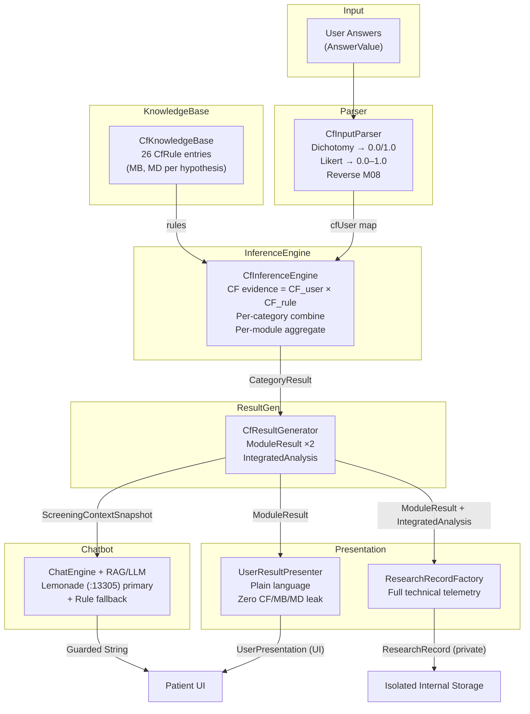
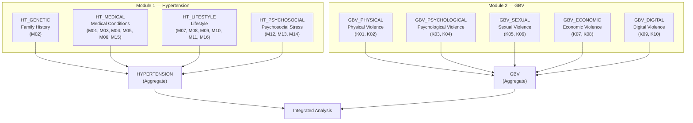

# Empati — Certainty Factor Expert System & Clinical Chatbot Documentation

> **Context Note:** Sections 1 and 2 below document the **active deterministic neuro-symbolic core** of Empati (`CfModels.kt`, `CfQuestions.kt`, `CfInputParser.kt`, `CfKnowledgeBase.kt`, `CfInferenceEngine.kt`, `CfResultGenerator.kt`, `UserResultPresenter.kt`). Section 3.6 reflects the pre-competition v3/v4 fallback notes; in the current **AMD Lemonade Challenge (`:13305`)** architecture, live AI consultation routes through `LemonadeUnifiedClient` (`Qwen3-4B`/`Qwen3-1.7B`) + `EmpatiVectorRag` (`nomic-embed-text-v1`, 30 chunks) + voice I/O (`Whisper-Large-v3-Turbo` & `kokoro-v1`), while deterministic rule-based replies serve as the offline fallback. See [`README.md`](README.md) and [`docs/specs/lemonade-hybrid-triage.md`](docs/specs/lemonade-hybrid-triage.md) for current details and test totals (`203` tests across `24` suites).
>
> **Runtime Localization Note:** Patient-facing questionnaire wording (`M01`–`M16`, `K01`–`K10`) and qualitative UI copy emitted by `UserResultPresenter` remain in **Bahasa Indonesia** inside the app to match Indonesian clinical guidelines (`Kemenkes RI`, **SAPA 129**). English translations are provided in parentheses/tables below for international reviewers.

---

## Table of Contents

- [Architecture Overview](#architecture-overview)
- [Part 1 — Certainty Factor Expert System](#part-1--certainty-factor-expert-system)
  - [1.1 Certainty Factor Theory](#11-certainty-factor-theory)
  - [1.2 Question Bank (26 Questions)](#12-question-bank-26-questions)
  - [1.3 Input Parser](#13-input-parser)
  - [1.4 Knowledge Base](#14-knowledge-base)
  - [1.5 Inference Engine](#15-inference-engine)
  - [1.6 Risk Level Classification](#16-risk-level-classification)
  - [1.7 Integrated Cross-Module Analysis](#17-integrated-cross-module-analysis)
  - [1.8 Result Generator](#18-result-generator)
- [Part 2 — Presentation & Research Separation Layer](#part-2--presentation--research-separation-layer)
  - [2.1 Dual Output Isolation](#21-dual-output-isolation)
  - [2.2 User Result Presenter](#22-user-result-presenter)
  - [2.3 Research Telemetry Records](#23-research-telemetry-records)
- [Part 3 — AI Consultation & Deterministic Rule Fallback](#part-3--ai-consultation--deterministic-rule-fallback)
  - [3.1 Rule-Based Fallback Engine (`ChatEngine.kt`)](#31-rule-based-fallback-engine-chatenginekt)
  - [3.2 Processing Pipeline](#32-processing-pipeline)
  - [3.3 Intent Taxonomy](#33-intent-taxonomy)
  - [3.4 Deterministic Fallback Responses (Translated)](#34-deterministic-fallback-responses-translated)
  - [3.5 Screening Context Integration](#35-screening-context-integration)
  - [3.6 Topic-Scoped LLM Integration Evolution](#36-topic-scoped-llm-integration-evolution)
- [Part 4 — Legacy v1 Scoring Engine](#part-4--legacy-v1-scoring-engine)
- [Part 5 — Multi-Domain Zero-Collision Storage](#part-5--multi-domain-zero-collision-storage)
- [Part 6 — Automated Verification](#part-6--automated-verification)
- [File References](#file-references)

---

## Architecture Overview



---

## Part 1 — Certainty Factor Expert System

### 1.1 Certainty Factor Theory

The **Certainty Factor (CF)** method introduced by Shortliffe & Buchanan (1975) in MYCIN models degree of clinical belief alongside graded respondent certainty.

#### Core Formulas

| Concept | Formula | Meaning |
|---|---|---|
| **Expert Rule CF** | $CF_{rule} = MB - MD$ | Net expert certainty (belief minus disbelief) |
| **Evidence CF** | $CF_{evidence} = CF_{user} \times CF_{rule}$ | Weighted evidence = respondent certainty × expert rule weight |

Where:
- **$MB$** (*Measure of Belief*): Range $[0, 1]$
- **$MD$** (*Measure of Disbelief*): Range $[0, 1]$
- **$CF_{user}$**: Respondent certainty derived from answer input, range $[0, 1]$
- **$CF_{rule}$**: Net rule weight, range $[-1, 1]$

#### Sequential Combination Formulas

When multiple pieces of evidence target the same hypothesis, CFs combine iteratively:

| Condition | Formula |
|---|---|
| Both positive ($CF_1 > 0$ and $CF_2 > 0$) | $CF_{combine} = CF_1 + CF_2 \times (1 - CF_1)$ |
| Both negative ($CF_1 < 0$ and $CF_2 < 0$) | $CF_{combine} = CF_1 + CF_2 \times (1 + CF_1)$ |
| Conflicting signs | $CF_{combine} = \dfrac{CF_1 + CF_2}{1 - \min(\|CF_1\|, \|CF_2\|)}$ |

> [!NOTE]
> Positive combinations **converge asymptotically toward 1.0**: corroborating risk factors reinforce confidence without ever exceeding `1.0`.

#### Implementation

```kotlin
// CfInferenceEngine.kt
fun combine(cf1: Double, cf2: Double): Double = when {
    cf1 == 0.0 -> cf2
    cf2 == 0.0 -> cf1
    cf1 > 0 && cf2 > 0 -> cf1 + cf2 * (1 - cf1)
    cf1 < 0 && cf2 < 0 -> cf1 + cf2 * (1 + cf1)
    else -> {
        val denominator = 1 - min(abs(cf1), abs(cf2))
        if (denominator == 0.0) 0.0 else (cf1 + cf2) / denominator
    }
}
```

---

### 1.2 Question Bank (26 Questions)

A total of **26 structured questions** divided across two independent modules:

#### Module 1 — Hypertension (`M01`–`M16`)

| ID | Category | Clinical Concept (Question Summary) | Type | Reverse |
|---|---|---|---|---|
| `M01` | Medical History | Previously diagnosed with hypertension by a healthcare professional? | Dichotomy | — |
| `M02` | Medical History | Parental or sibling history of hypertension? | Dichotomy | — |
| `M03` | Medical History | History of diabetes mellitus? | Dichotomy | — |
| `M04` | Medical History | Currently taking blood-pressure medication regularly? | Dichotomy | — |
| `M05` | Medical History | Most recent blood-pressure reading above 130/85 mmHg? | Dichotomy | — |
| `M06` | Medical History | Currently pregnant or delivered within the past 6 months? (No if N/A) | Dichotomy | — |
| `M07` | Lifestyle | Frequency of consuming salty or high-sodium foods? | Likert | — |
| `M08` | Lifestyle | Frequency of at least 30 minutes of physical activity? | Likert | Yes |
| `M09` | Lifestyle | Daily smoking or secondhand smoke exposure? | Dichotomy | — |
| `M10` | Lifestyle | Excessive coffee or caffeinated beverage intake? | Likert | — |
| `M11` | Lifestyle | Body weight tending toward overweight / obesity? | Dichotomy | — |
| `M12` | Psychosocial Risk | Frequency of severe work, study, or daily-duty stress in the past month? | Likert | — |
| `M13` | Psychosocial Risk | Habitually sleeping less than 7 hours per night? | Dichotomy | — |
| `M14` | Psychosocial Risk | Frequency of unexplained anxiety or feeling overwhelmed? | Likert | — |
| `M15` | Psychosocial Risk | Rarely checking blood pressure (fewer than once per year)? | Dichotomy | — |
| `M16` | Psychosocial Risk | Eating fast food more than 3 times per week? | Dichotomy | — |

#### Module 2 — Gender-Based Violence / GBV (`K01`–`K10`)

| ID | Category | Clinical Concept (Question Summary) | Type | Sensitive |
|---|---|---|---|---|
| `K01` | Physical Violence | Pushed, hit, slapped, or kicked at home, work, or social circles? | Likert | Yes |
| `K02` | Physical Violence | Objects thrown toward you or physical intimidation causing fear/harm? | Likert | Yes |
| `K03` | Psychological Violence | Insulted, yelled at, belittled, or humiliated by partner, family, supervisor, or peers? | Likert | Yes |
| `K04` | Psychological Violence | Deliberately ostracized, ignored, or isolated from social or daily activities? | Likert | Yes |
| `K05` | Sexual Violence | Unwanted sexual comments, jokes, or suggestive remarks at home, work, or public spaces? | Likert | Yes |
| `K06` | Sexual Violence | Unwanted sexual touch, coercion, advances, or pressure? | Likert | Yes |
| `K07` | Economic Violence | Income, money, or financial rights taken, withheld, or controlled without consent? | Likert | Yes |
| `K08` | Economic Violence | Blocked from working, earning income, studying, or advancing without valid cause? | Likert | Yes |
| `K09` | Digital Violence | Digital stalking, activity monitoring, or persistent harassing messages? | Likert | Yes |
| `K10` | Digital Violence | Online threats, intimidation, humiliation, or non-consensual sharing of personal info? | Likert | Yes |

#### Likert Scale Labels (`CF_user`)

| Value | Hypertension Scale (EN equiv.) | GBV Scale (EN equiv.) | `CF_user` |
|---|---|---|---|
| 1 | Never (*Tidak pernah*) | Never (*Tidak pernah*) | `0.0` |
| 2 | Rarely (*Jarang*) | Rarely (*Jarang*) | `0.2` |
| 3 | Sometimes (*Kadang-kadang*) | Fairly often (*Cukup sering*) | `0.5` |
| 4 | Often (*Sering*) | Often (*Sering*) | `0.8` |
| 5 | Very often (*Sangat sering*) | Very often (*Sangat sering*) | `1.0` |

---

### 1.3 Input Parser

**File:** [`CfInputParser.kt`](app/src/main/java/com/example/empati/data/cf/CfInputParser.kt)

Converts raw answers (`AnswerValue`) into deterministic `CF_user` weights:


- **Dichotomous Mapping**: `Yes (true) = 1.0`, `No (false) = 0.0`.
- **Standard Likert**: `1 → 0.0`, `2 → 0.2`, `3 → 0.5`, `4 → 0.8`, `5 → 1.0`.
- **Reverse Likert (`M08`)**: `1 → 1.0`, `2 → 0.8`, `3 → 0.5`, `4 → 0.2`, `5 → 0.0`.

> [!IMPORTANT]
> **`M08` is reverse-scored** because physical exercise is a protective habit: higher exercise frequency lowers `CF_user` and lowers overall risk.

#### Validation Rules
- `Unanswered` entries are omitted from `cfUser` (not defaulted to `0.0`).
- Type mismatches (e.g., Dichotomy supplied for a Likert question) or out-of-range Likert values (`< 1` or `> 5`) emit a `ValidationIssue`.

---

### 1.4 Knowledge Base

**File:** [`CfKnowledgeBase.kt`](app/src/main/java/com/example/empati/data/cf/CfKnowledgeBase.kt)

#### Rule Structure (`CfRule`)

```kotlin
data class CfRule(
    val id: String,              // "R-M01", "R-K03", etc.
    val questionId: String,      // "M01", "K03"
    val hypothesis: Hypothesis,  // target sub-hypothesis
    val mb: Double,              // Measure of Belief [0,1]
    val md: Double,              // Measure of Disbelief [0,1]
    val source: String,          // clinical citation
    val expertValidated: Boolean,// clinical panel validation flag
    val note: String             // validation status note
) {
    val cfPakar: Double get() = mb - md  // Net rule CF
}
```

> [!CAUTION]
> Current MB/MD rule weights carry `expertValidated = false` and `note = "NEEDS_EXPERT_VALIDATION"`. They are initial clinical prototype weights and **must undergo formal medical/psychosocial expert validation** prior to clinical deployment.

#### Hypertension Rules (16 Rules)

| Rule ID | Question | Hypothesis | `MB` | `MD` | `CF_rule` |
|---|---|---|---|---|---|
| `R-M01` | M01 | `HT_MEDICAL` | 0.95 | 0.05 | **0.90** |
| `R-M02` | M02 | `HT_GENETIC` | 0.85 | 0.10 | **0.75** |
| `R-M03` | M03 | `HT_MEDICAL` | 0.85 | 0.10 | **0.75** |
| `R-M04` | M04 | `HT_MEDICAL` | 0.80 | 0.10 | **0.70** |
| `R-M05` | M05 | `HT_MEDICAL` | 0.90 | 0.05 | **0.85** |
| `R-M06` | M06 | `HT_MEDICAL` | 0.70 | 0.15 | **0.55** |
| `R-M07` | M07 | `HT_LIFESTYLE` | 0.75 | 0.15 | **0.60** |
| `R-M08` | M08 | `HT_LIFESTYLE` | 0.70 | 0.15 | **0.55** |
| `R-M09` | M09 | `HT_LIFESTYLE` | 0.75 | 0.15 | **0.60** |
| `R-M10` | M10 | `HT_LIFESTYLE` | 0.65 | 0.20 | **0.45** |
| `R-M11` | M11 | `HT_LIFESTYLE` | 0.80 | 0.10 | **0.70** |
| `R-M12` | M12 | `HT_PSYCHOSOCIAL` | 0.75 | 0.15 | **0.60** |
| `R-M13` | M13 | `HT_PSYCHOSOCIAL` | 0.70 | 0.15 | **0.55** |
| `R-M14` | M14 | `HT_PSYCHOSOCIAL` | 0.75 | 0.15 | **0.60** |
| `R-M15` | M15 | `HT_MEDICAL` | 0.65 | 0.20 | **0.45** |
| `R-M16` | M16 | `HT_LIFESTYLE` | 0.65 | 0.20 | **0.45** |

#### GBV Rules (10 Rules)

| Rule ID | Question | Hypothesis | `MB` | `MD` | `CF_rule` |
|---|---|---|---|---|---|
| `R-K01` | K01 | `GBV_PHYSICAL` | 0.90 | 0.05 | **0.85** |
| `R-K02` | K02 | `GBV_PHYSICAL` | 0.85 | 0.10 | **0.75** |
| `R-K03` | K03 | `GBV_PSYCHOLOGICAL` | 0.85 | 0.10 | **0.75** |
| `R-K04` | K04 | `GBV_PSYCHOLOGICAL` | 0.80 | 0.10 | **0.70** |
| `R-K05` | K05 | `GBV_SEXUAL` | 0.90 | 0.05 | **0.85** |
| `R-K06` | K06 | `GBV_SEXUAL` | 0.95 | 0.03 | **0.92** |
| `R-K07` | K07 | `GBV_ECONOMIC` | 0.80 | 0.10 | **0.70** |
| `R-K08` | K08 | `GBV_ECONOMIC` | 0.80 | 0.10 | **0.70** |
| `R-K09` | K09 | `GBV_DIGITAL` | 0.75 | 0.10 | **0.65** |
| `R-K10` | K10 | `GBV_DIGITAL` | 0.80 | 0.10 | **0.70** |

#### Hypothesis Hierarchy



---

### 1.5 Inference Engine

**File:** [`CfInferenceEngine.kt`](app/src/main/java/com/example/empati/data/cf/CfInferenceEngine.kt)

#### Inference Algorithm

```text
For each MODULE:
  1. Filter rules belonging to the module
  2. Group rules by sub-hypothesis (category)
  3. For each category:
     a. For each rule in the category:
        - Look up CF_user from ParseResult
        - Compute CF_evidence = CF_user × CF_rule
     b. Combine all CF_evidence sequentially using combineAll()
     c. Store CategoryResult(hypothesis, cf, contributions)
  4. Module CF = combineAll(all category CFs)
  5. Level = levelOf(Module CF)
```

#### Worked Calculation Example

Suppose a respondent answers:
- `M01` = Yes (`CF_user = 1.0`)
- `M07` = Often/4 (`CF_user = 0.8`)
- `M08` = Often/4, reverse-scored (`CF_user = 0.2`)

**Step 1 — Per-Rule Evidence CF:**

| Rule | `CF_user` | `CF_rule` | `CF_evidence` |
|---|---|---|---|
| `R-M01` (`HT_MEDICAL`) | 1.0 | 0.90 | 0.900 |
| `R-M07` (`HT_LIFESTYLE`) | 0.8 | 0.60 | 0.480 |
| `R-M08` (`HT_LIFESTYLE`) | 0.2 | 0.55 | 0.110 |

**Step 2 — Category Combination:**
- **`HT_MEDICAL`**: Single rule `R-M01` → `CF = 0.900`
- **`HT_LIFESTYLE`**: Combine `0.480` and `0.110`: `0.480 + 0.110 × (1 − 0.480) = 0.5372`

**Step 3 — Aggregate Module CF:**
- `combine(0.900, 0.5372) = 0.900 + 0.5372 × (1 − 0.900) = 0.9537`

**Step 4 — Level:** `0.9537 ≥ 0.75` → **Very High (`SANGAT_TINGGI`)**

---

### 1.6 Risk Level Classification

| CF Range | Enum (`CfLevel`) | Display Classification |
|---|---|---|
| `CF < 0.25` | `RENDAH` | Low |
| `0.25 ≤ CF < 0.50` | `SEDANG` | Moderate |
| `0.50 ≤ CF < 0.75` | `TINGGI` | High |
| `CF ≥ 0.75` | `SANGAT_TINGGI` | Very High |

---

### 1.7 Integrated Cross-Module Analysis

**File:** [`CfResultGenerator.kt`](app/src/main/java/com/example/empati/data/cf/CfResultGenerator.kt) → `integrate()`

Once both modules are evaluated, `integrate()` assigns 1 of 6 outcome categories:

#### Decision Matrix

| HT Condition (`CF ≥ 0.25`) | GBV Condition (`CF ≥ 0.25`) | Additional Condition | Category |
|---|---|---|---|
| No | No | — | `LOW_RISK` |
| No | Yes | — | `GBV_ONLY` |
| Yes | Yes | — | `HYPERTENSION_WITH_GBV_INDICATION` |
| Yes | No | `hasDiagnosis = true` | `HYPERTENSION_MEDICAL_HISTORY` |
| Yes | No | dominant = `HT_LIFESTYLE` | `HYPERTENSION_LIFESTYLE_ONLY` |
| Yes | No | other | `HYPERTENSION_MEDICAL_HISTORY` |
| *(incomplete data)* | *(incomplete data)* | — | `INCONCLUSIVE` |

> [!IMPORTANT]
> The indication threshold (`INDICATION_THRESHOLD`) is **0.25**. Values below `0.25` are treated as insufficient indication.

#### Category Descriptions & Recommendations

| Category | Meaning & Non-Causal Framing | Guidance |
|---|---|---|
| `LOW_RISK` | Both modules remain below threshold | Maintain healthy habits + periodic BP checks |
| `GBV_ONLY` | GBV indicated without elevated HT risk | Independent GBV support + **SAPA 129** + psychological counseling |
| `HYPERTENSION_WITH_GBV_INDICATION` | Co-occurring risks (chronic stress pathway, **NOT causal proof**) | Medical follow-up + psychological support + **SAPA 129** |
| `HYPERTENSION_LIFESTYLE_ONLY` | Lifestyle risk factors dominate | Doctor/clinic visit + lifestyle adjustments |
| `HYPERTENSION_MEDICAL_HISTORY` | Clinical/medical history dominates | Regular BP monitoring + clinician medication review |
| `INCONCLUSIVE` | One or both modules incomplete | Complete both questionnaires |

---

### 1.8 Result Generator

**File:** [`CfResultGenerator.kt`](app/src/main/java/com/example/empati/data/cf/CfResultGenerator.kt)

`buildModuleResult()` executes parsing, inference, module CF aggregation, interpretation selection, top-3 dominant risk categories, and up to **5 protective factors** (for Hypertension: e.g., no hypertension diagnosis, normal BP, regular exercise `M08 ≥ 4`, non-smoking, healthy weight, adequate sleep, regular BP checks, avoiding fast food).

---

## Part 2 — Presentation & Research Separation Layer

### 2.1 Dual Output Isolation

```text
                    ModuleResult
                   (CF, MB/MD, evidence)
                        │
              ┌─────────┴─────────┐
              ▼                   ▼
    UserResultPresenter    ResearchRecordFactory
    (plain language)       (full CF audit)
              │                   │
              ▼                   ▼
    UserPresentation       ResearchRecord
    (shown in UI)          (stored privately)
```

- **Strictly Never Rendered to End Users**: raw CF decimals, MB/MD weights, rule/evidence IDs, percentages, inference terminology, numeric ring gauges, or `"CF 0.xx"` strings.
- **Rendered to End Users**: calm qualitative conclusions, plain-language contributing factors, protective strengths, next-step guidance, and clear screening disclaimers.

---

### 2.2 User Result Presenter

**File:** [`UserResultPresenter.kt`](app/src/main/java/com/example/empati/data/presentation/UserResultPresenter.kt)

Maps internal hypotheses and integrated categories into aligned qualitative badges (`LOW` / `MEDIUM` / `HIGH` / `VERY_HIGH` for Hypertension; `"Terdapat indikasi"` vs `"Tidak terindikasi"` for GBV) synchronized across `ResultScreen`, `HomeScreen`, and `HistoryScreen`.

---

### 2.3 Research Telemetry Records

**File:** [`ResearchModels.kt`](app/src/main/java/com/example/empati/data/research/ResearchModels.kt)

Stores full hierarchical CF telemetry (`ResearchRecord` → `ResearchModule` → `ResearchCategory` → `ResearchEvidence`) keyed strictly by one-way `subject_hash`, never rendered in UI or logged to Logcat.

---

## Part 3 — AI Consultation & Deterministic Rule Fallback

### 3.1 Rule-Based Fallback Engine (`ChatEngine.kt`)

**File:** [`ChatEngine.kt`](app/src/main/java/com/example/empati/data/ChatEngine.kt)

When all neural LLM backends are unreachable or offline, `ChatEngine` provides a deterministic rule-based Indonesian responder (`id-ID`) covering 9 core clinical intents (Screening Result, Prevention, Symptoms, Diet/Sodium, Stress, Physical Activity, Violence/SAPA 129 Safety, Hypertension Definition, Greeting) plus an out-of-scope fallback.

### 3.2 Processing Pipeline & 3.3–3.5 Screening Context Injection

Intent matching normalizes messages in `id-ID`, evaluates keywords in priority order, and injects qualitative context from `ScreeningResult` / `ScreeningContextSnapshot` while never leaking CF scores. GBV/safety triggers always attach the confidential **SAPA 129** hotline (`129` / WhatsApp `08111-129-129`).

### 3.6 Topic-Scoped LLM Integration Evolution

- Earlier v3/v4 iterations routed chat through local Ollama (`qwen2.5:3b-instruct`) or OpenRouter while preserving strict privacy input redaction and topic scoping.
- The **current AMD Lemonade architecture** replaces legacy `:11434` paths with unified **AMD Lemonade Server (`:13305`)** inference (`empati-llm` / `Qwen3-4B`, `empati-embed` / `nomic-embed-text-v1` cosine RAG over 30 chunks, `empati-stt` / `Whisper-Large-v3-Turbo`, `empati-tts` / `kokoro-v1`)—see [`README.md`](README.md).

---

## Part 4 — Legacy v1 Scoring Engine

**File:** [`ScreeningEngine.kt`](app/src/main/java/com/example/empati/data/ScreeningEngine.kt)

Retained in the repository for archival reference only; bypassed in UI flows since v2.0 in favor of the dual-module Certainty Factor engine.

---

## Part 5 — Multi-Domain Zero-Collision Storage

**Files:** [`EmpatiDatabase.kt`](app/src/main/java/com/example/empati/data/db/EmpatiDatabase.kt) & [`ScreeningStore.kt`](app/src/main/java/com/example/empati/data/ScreeningStore.kt)

Isolates authentication credentials (`auth_asn_users`), qualitative summaries (`user_screening_summaries`), pseudonymized CF research audits (`research_cf_records`), and RAG chunks/chat logs (`rag_knowledge_chunks`, `rag_chat_logs`). See [`DATABASE_AUTH_AND_RAG_ARCHITECTURE.md`](DATABASE_AUTH_AND_RAG_ARCHITECTURE.md).

---

## Part 6 — Automated Verification

The CF expert system, zero-leak presentation layer, PII redaction, RAG retrieval, and AMD Lemonade client contracts are covered by **203 passing JVM unit tests across 24 suites** on the active branch (`./gradlew testDebugUnitTest`; see [`README.md`](README.md#testing) for exact Java 21 execution instructions).

---

## File References

### Certainty Factor Expert System
| File | Description |
|---|---|
| [`CfModels.kt`](app/src/main/java/com/example/empati/data/cf/CfModels.kt) | Domain models, enums, `Hypothesis`, `CfLevel`, `ModuleResult`, `IntegratedAnalysis` |
| [`CfQuestions.kt`](app/src/main/java/com/example/empati/data/cf/CfQuestions.kt) | 26-question dual-module bank + Likert scales |
| [`CfInputParser.kt`](app/src/main/java/com/example/empati/data/cf/CfInputParser.kt) | Answer-to-`CF_user` parser (dichotomy, Likert, reverse `M08`, validation) |
| [`CfKnowledgeBase.kt`](app/src/main/java/com/example/empati/data/cf/CfKnowledgeBase.kt) | 26 `CfRule` entries with `MB`/`MD` weights per hypothesis |
| [`CfInferenceEngine.kt`](app/src/main/java/com/example/empati/data/cf/CfInferenceEngine.kt) | CF combination rules, category aggregation, `levelOf` |
| [`CfResultGenerator.kt`](app/src/main/java/com/example/empati/data/cf/CfResultGenerator.kt) | Builds module results, cross-module integration, recommendations, protective factors |

### Presentation & Research Telemetry
| File | Description |
|---|---|
| [`UserPresentation.kt`](app/src/main/java/com/example/empati/data/presentation/UserPresentation.kt) | User-safe presentation DTOs (zero CF fields) |
| [`UserResultPresenter.kt`](app/src/main/java/com/example/empati/data/presentation/UserResultPresenter.kt) | Translates technical CF outputs into plain empathetic language |
| [`ResearchModels.kt`](app/src/main/java/com/example/empati/data/research/ResearchModels.kt) | Full technical CF models for dissertation research |

### Chatbot, Legacy & Storage
| File | Description |
|---|---|
| [`ChatEngine.kt`](app/src/main/java/com/example/empati/data/ChatEngine.kt) | Orchestrates Lemonade + Vector RAG chat and deterministic fallback |
| [`ScreeningEngine.kt`](app/src/main/java/com/example/empati/data/ScreeningEngine.kt) | Legacy v1 scoring engine (inactive in UI) |
| [`ScreeningStore.kt`](app/src/main/java/com/example/empati/data/ScreeningStore.kt) | Local persistence & sync bridge |
| [`Models.kt`](app/src/main/java/com/example/empati/data/Models.kt) | Core app models (`Question`, `ScreeningResult`, `UserProfile`) |
