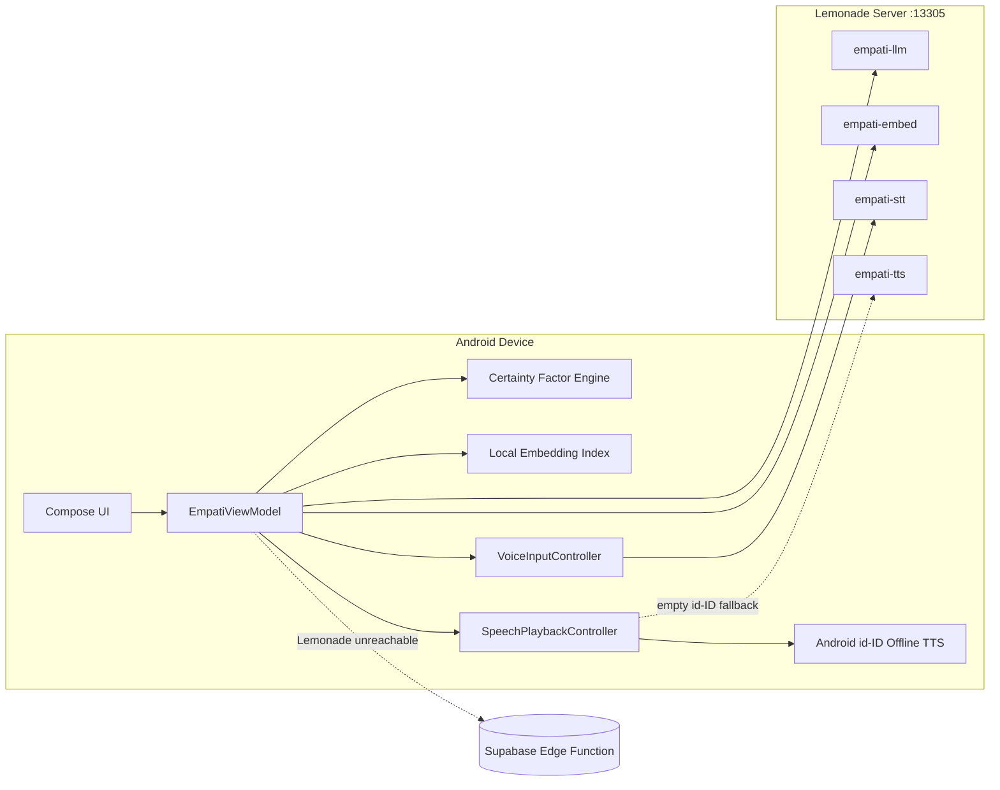

# Empati

> **AMD Lemonade Developer Challenge 2026 Submission**
>
> **Empati** is a local-first, trauma-informed Android clinical triage and counseling companion powered by a **single AMD Lemonade Server (`:13305`)**. It pairs a **deterministic neuro-symbolic Certainty Factor expert engine** (26 screening rules across hypertension & gender-based psychosocial risk) with a **grounded local omni-modal RAG pipeline** (`Qwen3-4B-GGUF`, `nomic-embed-text-v1-GGUF`, `Whisper-Large-v3-Turbo`, plus `kokoro-v1` server contract & offline Android `id-ID` TTS for natural Indonesian speech).
>
> **Why Empati Stands Out:**
> - **Clinical Safety by Separation of Concerns:** `CfEngine` computes risk levels, dominant categories, and protective factors deterministically in Kotlin; `Qwen3-4B` only narrates verified `empati.screening_context/v1` state and retrieved Indonesian/WHO clinical chunks (`30` embedded chunks + lexical fallback). `AnswerGuardrail` blocks expert-weight leaks and deterministically preserves crisis hotlines (`SAPA 129`).
> - **Alias-Driven Unified Lemonade Client (`:13305`):** Zero hardcoded model IDs in Kotlin — operators can swap models on Lemonade via `empati-llm`, `empati-llm-backup`, `empati-embed`, `empati-stt`, and `empati-tts` without rebuilding the APK.
> - **Natural Offline Indonesian Voice + Multimodal Input:** `VoiceInputController` records 16 kHz mono WAV -> `empati-stt` (`Whisper-Large-v3-Turbo`). Because upstream `kokoro-v1` lacks Indonesian phonetics, `HybridSpeechSynthesizer` prioritizes offline on-device Android `id-ID` TTS (zero cloud network leak) and falls back gracefully to Lemonade `empati-tts`.
> - **Measured Local AMD Hardware Benchmark (`scripts/bench-empati.ps1 -Repeats 5`, `2026-11-14` on `AMD Ryzen 7 7735HS`, `AMD Radeon(TM) Graphics`, `15.25 GB` unified RAM, Lemonade `v2026.46.2`):** `embeddings: 44.1 ms (5/5)`, `speech: 1436.3 ms (5/5)`, `transcription: 10575.1 ms (5/5)`, `chat (64 tokens, all 4 models resident concurrently): 33704.2 ms (5/5)` — see [`docs/BENCHMARK_EVALUATION.md`](docs/BENCHMARK_EVALUATION.md) for memory-paging analysis vs. 32 GB+ Strix Halo targets.
> - **Verified Quality:** **203 passing JVM unit tests (24 suites)**, Compose screenshot previews, and automated setup/dry-run verification (`scripts/tests/verify-dryrun.ps1`).

---

Empati is an Android application for hypertension risk and psychosocial well-being screening, followed by guided counseling conversations running on a local **AMD Lemonade Server**. Screening uses a deterministic Certainty Factor expert engine. Follow-up counseling uses a local language model strictly to narrate those screening outputs and curated reference excerpts retrieved via embeddings, ensuring that risk levels always originate from deterministic code rather than generative guesswork.

This project is built for the **AMD Lemonade Developer Challenge 2026** and dissertation research on gender-aware hypertension screening. The patient-facing UI, clinical knowledge corpus (`EmpatiCorpus`), and voice output target **Bahasa Indonesia** healthcare accessibility (`SAPA 129`, Indonesian Ministry of Health / Kemenkes, WHO), while repository documentation, scripts, and walkthrough guides are written in **English** for judges and contributors.

## Status

Working and verified in code:

- Two-module bilingual clinical screening: 16 hypertension items and 10 gender-based violence (GBV) psychosocial items backed by the Shortliffe & Buchanan Certainty Factor engine and integrated cross-domain analysis.
- Unified Lemonade HTTP client on port `13305` handling chat, embeddings, speech-to-text, and text-to-speech. Model IDs never appear in Kotlin source code—only stable contract aliases.
- Local vector retrieval (`EmbeddingIndex`) with similarity threshold (`0.35`), lexical fallback, and clickable source citation chips covering `30` curated clinical chunks.
- Single-bubble SSE streaming chat, partial-response recovery on disconnects, post-generation output guardrails, and explicit server capability states distinguishing offline server, loading model, and busy slots.
- 16 kHz mono WAV voice input with a 60-second recording cap (`empati-stt`) and offline-first Indonesian voice synthesis via `AndroidIndonesianTtsSynthesizer` (`id-ID`) with graceful fallback to Lemonade `empati-tts` and SHA-256 local disk caching.
- Measured 5x repeated hardware benchmarks on an AMD developer laptop (`AMD Ryzen 7 7735HS`, `15.25 GB` unified RAM, Lemonade `v2026.46.2`) recorded in [`docs/BENCHMARK_EVALUATION.md`](docs/BENCHMARK_EVALUATION.md).
- **203 passing JVM unit tests across 24 suites** plus Compose screenshot tests.

Not finished yet (explicitly not claimed as complete):

- Has not yet been benchmarked directly on a Ryzen AI Max+ 395 (`Strix Halo` 32–128 GB) system; Strix Halo numbers in [`docs/BENCHMARK_EVALUATION.md`](docs/BENCHMARK_EVALUATION.md) remain theoretical memory-bandwidth capacity estimates, while measured results come from `AMD Ryzen 7 7735HS` (`15.25 GB`).
- No dedicated UI consent toggle gate yet for disabling optional Supabase cloud fallback.
- Local embedding vectors persist as JSON in `SharedPreferences` rather than binary `float32` blobs in SQLite as outlined in the original spec.
- Citation chip matching checks publisher/title tokens, so mentioning one publisher name can highlight multiple retrieved chunks from that publisher.
- Guardrails block explicit score tokens (`CF`, `MB`, `MD`, `%`, decimal `0.xx dari 1.00`), but do not yet reject every standalone `0–100` integer or assert semantic equivalence between narration text and CF level labels (stricter numeric filtering must avoid stripping valid blood pressure thresholds like `140/90` or hotline `129`).
- Backup path status details render inside the chat header/banner rather than inside the Profile screen.
- Certainty Factor expert weights are still research placeholders pending formal clinician validation.
- No CI pipeline, release signing config, or third-party security audit yet.

## Architecture



Role separation is strictly enforced. `CfEngine` computes the risk level, dominant categories, and protective factors. `HybridTriageBridge` serializes those results into `empati.screening_context/v1`. `EmpatiPromptBuilder` builds a grounded prompt with retrieved reference excerpts. `AnswerGuardrail` validates the generated text before rendering. The LLM never recomputes risk scores and never issues a medical diagnosis.

Conversation orchestration lives in `EmpatiChatUseCase`, decoupled behind ports for gateway, retriever, and triage context. `GroundedChatGateway` targets local Lemonade first, forwards the same grounded prompt to Supabase Edge Function `empati-chat` only if Lemonade fails, and drops back to a deterministic offline composer (`ChatFallbackLadder`).

## Running Locally

Prerequisites:

- Android Studio with SDK 37 and JDK 17+.
- PowerShell 7.
- AMD Lemonade Server supporting `/v1/chat/completions`, `/v1/embeddings`, `/v1/audio/transcriptions`, and `/v1/audio/speech`.
- AMD Ryzen/Radeon hardware supported by Lemonade (or Android Emulator pointed at host `10.0.2.2`).

Set up the Lemonade server:

```powershell
pwsh ./scripts/setup-empati-lemonade.ps1
```

This script configures `host=0.0.0.0`, pulls all five models, registers aliases, verifies `/v1/models`, and runs `lemonade bench` plus `scripts/bench-empati.ps1`. Pass `-LocalOnly` to bind strictly to `127.0.0.1`, `-SkipPull` if models are already downloaded, and `-DryRun` to preview commands without executing them. When binding on a LAN interface, restrict firewall access and set `LEMONADE_API_KEY`.

Build configuration lives in `local.properties` (or environment variables):

```properties
LEMONADE_BASE_URL=http://10.0.2.2:13305
LEMONADE_API_KEY=
```

Both properties flow into `BuildConfig`, so host and port never require source edits. For physical Android phones connected over USB, forward the local port and point the build to loopback:

```bash
adb reverse tcp:13305 tcp:13305
# set LEMONADE_BASE_URL=http://127.0.0.1:13305 in local.properties
```

If connecting over Wi-Fi LAN in debug builds, [`app/src/debug/res/xml/network_security_config.xml`](app/src/debug/res/xml/network_security_config.xml) permits LAN cleartext HTTP, whereas release builds strictly lock cleartext traffic to `10.0.2.2`, `127.0.0.1`, and `localhost`.

Build and install the Android app:

```bash
./gradlew assembleDebug
./gradlew installDebug
```

## Models and Aliases

Aliases serve as the contract between Android client and server. Swap underlying models on Lemonade without rebuilding the APK:

| Alias | Model | Role |
|---|---|---|
| `empati-llm` | `Qwen3-4B-GGUF` | Primary grounded counseling chat |
| `empati-llm-backup` | `Qwen3-1.7B-GGUF` | Lightweight server-side backup model |
| `empati-embed` | `nomic-embed-text-v1-GGUF` | Corpus & query embeddings |
| `empati-stt` | `Whisper-Large-v3-Turbo` | 16 kHz Indonesian voice transcription |
| `empati-tts` | `kokoro-v1` | Server speech synthesis contract (fallback) |

The app calls four active contract aliases on `:13305`. Because upstream `kokoro-v1` does not include Indonesian phonetics, `HybridSpeechSynthesizer` prioritizes offline `id-ID` synthesis on Android for natural pronunciation with zero cloud traffic, falling back to `empati-tts` when an offline voice pack is absent. `empati-llm-backup` is pulled by setup scripts for instant server-side failover. Detailed wire contracts and model rationale live in [`docs/research/lemonade-omnimodal-spec.md`](docs/research/lemonade-omnimodal-spec.md).

## Testing

```bash
./gradlew testDebugUnitTest
./gradlew updateDebugScreenshotTest
```

Unit tests cover Certainty Factor inference, result presentation, Lemonade HTTP wire contracts, SSE parsing, output guardrails, fallback ladder behavior, local embedding retrieval and citations, voice input state machine, TTS caching and playback routing, and server capability checks (**24 suites, 203 tests, 0 failures**). Screenshot tests cover onboarding, results, chat, voice controls, and server status UI.

Run the standalone script dry-run verifier (no Lemonade installation required):

```powershell
pwsh ./scripts/tests/verify-dryrun.ps1
```

## Benchmarks

`scripts/bench-empati.ps1` measures chat completion, embeddings, transcription, and TTS synthesis, saving outputs to `docs/BENCHMARK_RESULTS.md` (gitignored so machine-specific numbers stay separated from source control). Full methodology, measured `2026-11-14` developer benchmarks (`AMD Ryzen 7 7735HS`), and Strix Halo capacity modeling are documented in [`docs/BENCHMARK_EVALUATION.md`](docs/BENCHMARK_EVALUATION.md).

## Privacy and Outbound Data Paths

The core triage and counseling loop executes locally on-device and on local Lemonade. Voice recordings are never uploaded to external third parties. Synthesized speech is cached internally and played locally via `MediaPlayer`.

Operators should be aware of two optional outbound paths:

- If Lemonade is unreachable, `GroundedChatGateway` can invoke Supabase Edge Function `empati-chat` with the structured screening context and retrieved clinical excerpts (currently active without a dedicated UI toggle).
- Authenticated account mode syncs anonymized research records and profile data to Supabase using a one-way `subject_hash` rather than direct identifiers.

For strict air-gapped clinical deployments, omit Supabase configuration / network access on the tablet or remove sync calls in account setup.

## Clinic, Campus, and Counseling Deployments

Small clinics or university counseling centers can deploy a single AMD host running Lemonade Server on an isolated LAN and install the Empati APK onto consultation tablets. Guided voice input lowers barriers for clients uncomfortable typing sensitive trauma or health histories while retaining local screening history on-device.

Under the **MIT License**, local teams can replace the clinical corpus, expand Certainty Factor questions, or swap models via aliases at zero per-token API cost.

## Path to Production

Recommended engineering steps before moving beyond competition & research demos:

1. Clinically validate Certainty Factor expert weights with medical practitioners and version the knowledge base.
2. Add an explicit user consent toggle for cloud fallback, defaulting strict offline-only mode.
3. Migrate the embedding vector store from SharedPreferences JSON to binary SQLite `float32` blobs per spec.
4. Harden post-generation numeric checks alongside domain-aware allowlists for BP readings and crisis numbers.
5. Profile Time-To-First-Token (TTFT), concurrent STT+chat memory usage, and thermals on target 32 GB+ Strix Halo hardware.
6. Wire automated GitHub Actions CI for `testDebugUnitTest`, screenshot tests, and `verify-dryrun.ps1`.
7. Configure release signing keys, full R8 minification, and network traffic audits.
8. Add instrumented Android UI & real-microphone/playback integration tests.

## License

MIT — full text in [`LICENSE`](LICENSE).

## Repository Layout

```text
app/                     Android application (Kotlin, Jetpack Compose)
  src/main/java/com/example/empati/
    data/chat/           Chat orchestration, gateway, guardrails, fallback ladder
    data/lemonade/       Unified HTTP client, build config, server capability parser
    data/retrieval/      Embeddings client, local vector index, citation selector
    data/speech/         16 kHz recorder, STT, Indonesian & Kokoro TTS routing/cache
    data/triage/         Context JSON serializer and grounded prompt builder
    data/rag/            Curated WHO / Kemenkes clinical corpus & legacy adapters
    ui/                  Soft Daylight theme, screens, and Compose components
  src/test/              203 JVM unit tests across 24 suites
  src/screenshotTest/    Compose screenshot tests
docs/
  adr/                   Architecture Decision Records (ADR 001)
  audit/                 Deep architecture audit & remediation tracking
  specs/                 Feature & triage specifications
  research/              Lemonade omni-modal wire spec & RAG evaluation
  BENCHMARK_EVALUATION.md
  YOUTUBE_DEMO_SCRIPT.md
scripts/
  setup-empati-lemonade.ps1
  bench-empati.ps1
  tests/verify-dryrun.ps1
supabase/                Research DB schema migrations & empati-chat Edge Function
```

Additional root technical reference files — including [`EXPERT_SYSTEM.md`](EXPERT_SYSTEM.md), [`FRONTEND_DESIGN.md`](FRONTEND_DESIGN.md), [`TYPOGRAPHY_AND_CLINICAL_UX.md`](TYPOGRAPHY_AND_CLINICAL_UX.md), and [`DATABASE_AUTH_AND_RAG_ARCHITECTURE.md`](DATABASE_AUTH_AND_RAG_ARCHITECTURE.md) — cover individual subsystems in detail.
