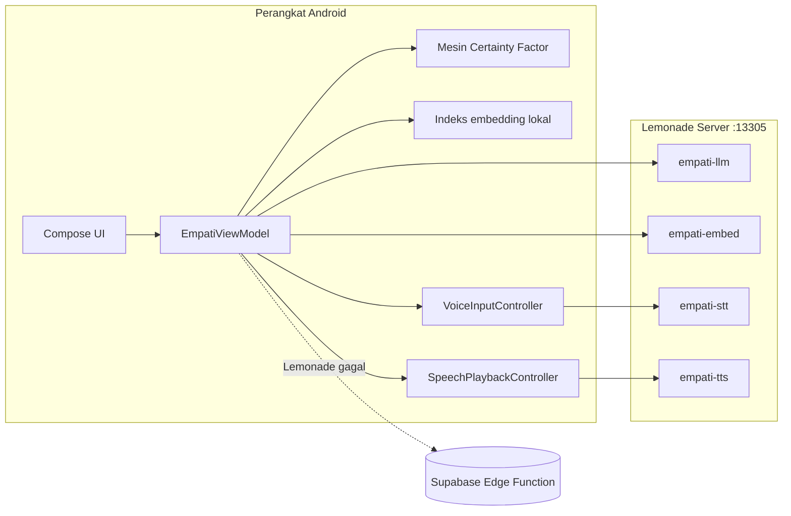

# Empati

Empati adalah aplikasi Android untuk skrining risiko hipertensi dan kesejahteraan psikososial, lalu percakapan lanjutan dengan asisten yang berjalan di Lemonade Server pada perangkat yang sama. Skrining memakai Certainty Factor deterministik. Percakapan memakai model bahasa lokal untuk menarasikan hasil itu dan potongan rujukan yang ditemukan lewat embedding, sehingga angka risiko tetap berasal dari kode, bukan dari model.

Aplikasi ini dibuat untuk submisi AMD Lemonade Developer Challenge 2026 dan untuk penelitian disertasi tentang skrining hipertensi berbasis gender. Repositori berisi aplikasi Android, korpus rujukan, dua skrip PowerShell untuk menyiapkan server dan mengukur latensi, serta catatan arsitektur.

## Status

Yang sudah berjalan di kode:

- Skrining dua modul, 16 pertanyaan hipertensi dan 10 pertanyaan kekerasan berbasis gender, dengan mesin Certainty Factor dan analisis integrasi.
- Klien Lemonade tunggal di port 13305 untuk chat, embedding, transkripsi, dan sintesis suara. Nama model tidak ada di kode aplikasi, hanya alias.
- Retrieval lokal dengan penyimpanan vektor, ambang skor, dan chip sitasi untuk potongan yang disebut dalam jawaban.
- Chat streaming, pemulihan jawaban parsial, guardrail keluaran, serta status capability yang membedakan server mati, model dimuat, dan model sibuk.
- Input suara 16 kHz mono dengan batas 60 detik dan output suara dengan cache mp3.
- 50 unit test JVM dan 44 preview screenshot Compose.

Yang belum selesai dan tidak diklaim selesai:

- Angka benchmark di `docs/BENCHMARK_EVALUATION.md` masih kosong. Belum ada pengukuran yang dijalankan di perangkat Strix Halo untuk repositori ini.
- Belum ada gerbang persetujuan pengguna untuk fallback cloud Supabase.
- Indeks vektor disimpan sebagai JSON di SharedPreferences, bukan blob float32 di SQLite seperti rencana awal.
- Chip sitasi memakai nama penerbit sebagai sinyal, jadi satu penyebutan penerbit dapat menandai beberapa potongan dari penerbit yang sama.
- Guardrail belum menolak semua angka 0 sampai 100 yang berdiri sendiri dan belum memverifikasi bahwa level risiko yang disebut model sama dengan keluaran mesin CF. Aturan angka yang lebih ketat perlu dirancang hati-hati karena angka klinis sah seperti 140/90 dan 129 akan ikut terkena.
- Status jalur cadangan tampil di layar chat, belum di layar Profil seperti rencana awal.
- Bobot Certainty Factor masih placeholder dan belum divalidasi tenaga kesehatan.
- Belum ada CI, signing release, atau audit keamanan pihak ketiga.

## Arsitektur



Pembagian tugasnya sengaja kaku. `CfEngine` menghitung level, kategori dominan, dan faktor protektif. `HybridTriageBridge` mengubah hasil itu menjadi konteks `empati.screening_context/v1` untuk model. `EmpatiPromptBuilder` menyusun prompt dengan potongan rujukan. `AnswerGuardrail` memeriksa teks akhir sebelum ditampilkan. Model tidak menghitung ulang angka dan tidak menentukan diagnosis.

Alur chat ada di `EmpatiChatUseCase`, dengan port untuk gateway, retriever, dan sumber konteks triage. `GroundedChatGateway` memanggil Lemonade, meneruskan prompt yang sama ke Supabase Edge Function bila Lemonade gagal, lalu jatuh ke penyusun offline. `ChatFallbackLadder` menguji urutan itu.

## Menjalankan

Prasyarat:

- Android Studio dengan SDK 37 dan JDK 17 atau lebih baru.
- PowerShell 7.
- Lemonade Server yang mendukung endpoint `/v1/chat/completions`, `/v1/embeddings`, `/v1/audio/transcriptions`, dan `/v1/audio/speech`.
- Perangkat AMD dengan driver yang sudah mendukung Lemonade. Emulator Android juga bisa dipakai dengan host `10.0.2.2`.

Siapkan server:

```powershell
pwsh ./scripts/setup-empati-lemonade.ps1
```

Skrip mengatur `host=0.0.0.0`, menarik lima model, memasang alias, memeriksa `/v1/models`, lalu menjalankan `lemonade bench` dan `scripts/bench-empati.ps1`. Pakai `-LocalOnly` untuk tetap di `127.0.0.1`, `-SkipPull` bila model sudah ada, dan `-DryRun` untuk melihat perintah tanpa mengeksekusi. Bila server dibuka ke LAN, batasi jaringannya dan set `LEMONADE_API_KEY` di server.

Konfigurasi build ada di `local.properties`:

```properties
LEMONADE_BASE_URL=http://10.0.2.2:13305
LEMONADE_API_KEY=
```

`LEMONADE_BASE_URL` dan `LEMONADE_API_KEY` juga bisa datang dari variabel lingkungan. Keduanya masuk ke `BuildConfig`, jadi host dan port tidak perlu diubah di kode. Untuk perangkat fisik lewat USB, jalankan `adb reverse tcp:13305 tcp:13305` dan pakai `http://127.0.0.1:13305`. Bila memakai IP LAN, tambahkan IP itu ke `app/src/main/res/xml/network_security_config.xml`; konfigurasi bawaan hanya mengizinkan HTTP polos ke `10.0.2.2`, `127.0.0.1`, dan `localhost`.

Build dan pasang:

```bash
./gradlew assembleDebug
./gradlew installDebug
```

## Model dan alias

Alias adalah kontrak antara aplikasi dan server. Ganti model cukup di server, tanpa membangun ulang APK.

| Alias | Model | Kegunaan |
|---|---|---|
| `empati-llm` | `Qwen3-4B-GGUF` | Chat utama |
| `empati-llm-backup` | `Qwen3-1.7B-GGUF` | Cadangan yang disiapkan skrip |
| `empati-embed` | `nomic-embed-text-v1-GGUF` | Embedding korpus dan kueri |
| `empati-stt` | `Whisper-Large-v3-Turbo` | Transkripsi suara |
| `empati-tts` | `kokoro-v1` | Sintesis suara |

Aplikasi memakai empat alias yang tercantum di kontraknya. Alias cadangan disiapkan untuk failover manual di sisi server; aplikasi tetap memanggil `empati-llm`. Detail endpoint dan alasan pemilihan model ada di `docs/research/lemonade-omnimodal-spec.md`.

## Pengujian

```bash
./gradlew testDebugUnitTest
./gradlew updateDebugScreenshotTest
```

Unit test mencakup Certainty Factor, presentasi hasil, kontrak HTTP Lemonade, parsing SSE, guardrail, fallback ladder, retrieval dan sitasi, state machine input suara, cache dan pemutaran suara, serta status capability. Preview screenshot mencakup alur onboarding, hasil, chat, kontrol suara, dan status server.

Pemeriksaan cepat skrip tanpa Lemonade terpasang:

```powershell
pwsh ./scripts/tests/verify-dryrun.ps1
```

## Benchmark

`scripts/bench-empati.ps1` mengukur chat, embedding, transkripsi, dan TTS, lalu menulis `docs/BENCHMARK_RESULTS.md`. Metodologi, template tabel, dan analisis batas memori Strix Halo ada di `docs/BENCHMARK_EVALUATION.md`. Berkas hasil tidak disimpan di repositori karena bergantung pada mesin yang dipakai.

## Privasi dan jalur data keluar

Jalur utama aplikasi berjalan di perangkat. Rekaman tidak dikirim ke layanan pihak ketiga. Audio balasan disimpan di cache internal dan diputar lewat MediaPlayer.

Ada dua jalur keluar yang perlu diketahui operator:

- Bila Lemonade gagal, `GroundedChatGateway` dapat memanggil Supabase Edge Function `empati-chat`. Prompt yang dikirim berisi konteks skrining dan potongan rujukan. Saat ini jalur ini aktif tanpa gerbang persetujuan.
- Alur akun menyinkronkan data penelitian dan profil ke Supabase setelah login. Data penelitian memakai `subject_hash`, bukan identitas langsung.

Untuk pemakaian yang benar-benar luring, jalankan aplikasi tanpa konfigurasi Supabase dan hapus pemanggilan sinkronisasi pada alur akun, atau blokir jaringan pada perangkat. Langkah itu belum dibungkus sebagai sakelar aplikasi dan masih menjadi pekerjaan produksi.

## Pemakaian di klinik, kampus, dan layanan konseling

Klinik kecil bisa menempatkan satu server di ruang perawat dan memasang APK di tablet konsultasi. Kampus bisa memakai satu server untuk beberapa laboratorium, dengan catatan kapasitas perlu diukur untuk akses bersamaan. Layanan konseling bisa memakai alur suara untuk klien yang lebih nyaman bercerita lisan, lalu menyimpan hasil skrining secara lokal.

Biaya operasional utama ada pada perangkat dan listrik, bukan langganan model. Lisensi MIT mengizinkan perubahan untuk kebutuhan lokal, termasuk mengganti korpus rujukan atau menambah pertanyaan skrining. Panduan pemasangan ada di bagian Menjalankan, dan skrip penyiapan tidak memerlukan akun cloud.

## Menuju produksi

Urutan yang saya sarankan sebelum dipakai di luar demo:

1. Validasi bobot Certainty Factor bersama tenaga kesehatan dan catat versi basis aturan.
2. Tambahkan sakelar persetujuan cloud, lalu matikan fallback Supabase secara bawaan.
3. Pindahkan indeks vektor ke SQLite sebagai blob float32 dengan panjang dan hash, sesuai spesifikasi.
4. Perketat guardrail angka dan tambahkan uji kepatuhan terhadap level risiko.
5. Ukur TTFT, latensi STT dan TTS, serta pemakaian memori pada perangkat target, lalu simpan hasilnya.
6. Siapkan CI untuk unit test, screenshot test, dan pemeriksaan dry-run skrip.
7. Ganti signing debug dengan kunci rilis, aktifkan R8 penuh, dan audit izin serta lalu lintas jaringan.
8. Tambahkan instrumented test untuk alur suara dan pemutaran audio di perangkat nyata.

## Lisensi

MIT. Teks lengkap ada di `LICENSE`.

## Struktur repositori

```text
app/                     Aplikasi Android (Kotlin, Compose)
  src/main/java/com/example/empati/
    data/chat/           Orkestrasi chat, gateway, guardrail, fallback
    data/lemonade/       Klien HTTP, konfigurasi, status, kapabilitas
    data/retrieval/      Embedding, indeks lokal, pemilih sitasi
    data/speech/         Rekaman, transkripsi, cache dan pemutaran TTS
    data/triage/         Skema konteks dan penyusun prompt
    data/rag/            Korpus rujukan dan adaptor lama
    ui/                  Layar dan komponen Soft Daylight
  src/test/              50 unit test JVM
  src/screenshotTest/    44 preview screenshot Compose
docs/
  adr/                   Keputusan arsitektur
  specs/                 Spesifikasi tiket
  research/              Catatan endpoint Lemonade
  BENCHMARK_EVALUATION.md
  YOUTUBE_DEMO_SCRIPT.md
scripts/
  setup-empati-lemonade.ps1
  bench-empati.ps1
  tests/verify-dryrun.ps1
supabase/                Skema riset dan Edge Function
```

Dokumen lain di akar repositori, seperti `FRONTEND_DESIGN.md` dan `EXPERT_SYSTEM.md`, menjelaskan sistem desain dan mesin pakar secara terpisah.
